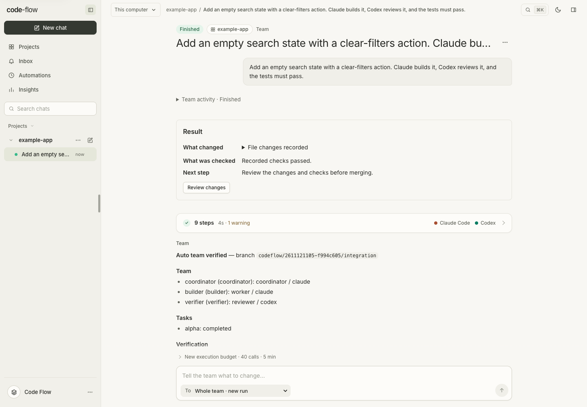
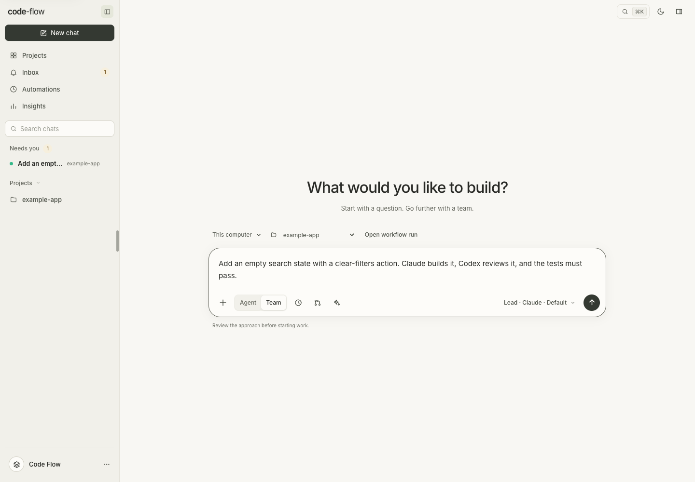

<p align="center">
  
</p>
<h1 align="center">code-flow</h1>
<p align="center">Your coding agents. One workspace.</p>
<p align="center">
  Bring Claude Code, Codex and Antigravity together to plan, build and review.<br>
  Use your installed CLIs and existing logins, with work you can inspect before shipping.
</p>
<p align="center">
  <a href="#try-the-preview">Try the preview</a> ·
  <a href="https://midhunxavier.github.io/code-flow/">Documentation</a> ·
  <a href="docs/patterns.md">Workflows</a> ·
  <a href="docs/security.md">Security</a>
</p>

## Quickstart

### Try the preview

Run Code Flow locally and open it in your browser with one command:

```bash
npx --yes --package=https://github.com/midhunxavier/code-flow/releases/download/v0.1.0-preview.9/midhunxavier-code-flow-0.1.0-preview.9.tgz codeflow
```

Requires **Node.js 22.13+**, **Git 2.38+**, and at least one supported CLI: `claude`, `codex` or `agy`, installed and signed in. Works on macOS, Linux and Windows through **WSL2**. Keep the terminal open while you work; press **Ctrl+C** to stop.

Prefer a macOS app? Download **0.1.0-preview.9** for your Mac:

| Apple Silicon (M1 or later) | Intel |
| --- | --- |
| [Download Apple Silicon DMG](https://github.com/midhunxavier/code-flow/releases/download/v0.1.0-preview.9/code-flow-0.1.0-preview.9-macos-arm64-unnotarized.dmg) | [Download Intel DMG](https://github.com/midhunxavier/code-flow/releases/download/v0.1.0-preview.9/code-flow-0.1.0-preview.9-macos-x64-unnotarized.dmg) |

Requires **macOS 13+**. Open the DMG, drag **Code Flow** to **Applications**, then open it in its own desktop window. Closing the window keeps agents running; use **Code Flow → Quit** to stop the app. Node is bundled; Git, a signed-in agent CLI and Chrome or Edge for the shared browser are still required. These DMGs are **unnotarized preview builds** and macOS may block them; use npm if blocked.

[Preview release notes and checksums](https://github.com/midhunxavier/code-flow/releases/tag/v0.1.0-preview.9) · [Installation and first-run guide](docs/getting-started.md)

Download the **Windows desktop preview using WSL2**: [x64 ZIP](https://github.com/midhunxavier/code-flow/releases/download/v0.1.0-preview.9/code-flow-0.1.0-preview.9-windows-x64-unsigned.zip) · [ARM64 ZIP](https://github.com/midhunxavier/code-flow/releases/download/v0.1.0-preview.9/code-flow-0.1.0-preview.9-windows-arm64-unsigned.zip). Extract the entire ZIP and open **Code Flow.exe**.
It bundles Node.js and runs the backend in your Linux distribution, reusing the Git and
agent CLI installations and logins there. Docker Desktop is not required. See the
[Windows desktop guide](docs/windows-desktop.md) for setup and validation status. The portable ZIP is unsigned.

### Run from source

With Node.js, Git and a signed-in agent CLI installed:

```bash
git clone https://github.com/midhunxavier/code-flow.git
cd code-flow
npm ci
npm start
```

Open [localhost:4317](http://localhost:4317), or use the owner link printed in the terminal if sign-in is required.

1. Choose **New chat**, then select or create a project and its Git repository.
2. Keep **Agent** selected for a normal agent conversation, or choose **Team** to discuss an approach with a lead.
3. Describe your goal. In Team mode, review the task-specific participants, models, efforts, source, checks and limits, then select **Start task**.
4. Continue in the same chat. Inspect the result and its evidence before applying changes or opening a pull request.

Each chat can contain multiple independently approved tasks. Agent/Team and model changes apply to future messages; accepted executions retain their reviewed settings. **Task details** shows participation receipts, allowances, preserved worktrees and history. No preset or saved agent team is needed.

Changes live in separate Git worktrees. The [chat guide](docs/conversational-tasks.md) explains guidance, queued messages, source handoffs and recovery. **Existing workflows** retains the workflow composer and its saved drafts, including remote, template and automation workflows.

Prefer working in your Claude Code or Codex CLI conversation? The experimental [conversational teams integration](docs/cli-conversational-teams.md) creates a task-specific team and process through a project MCP connection. Run `codeflow init` in your target repository using an installed launcher; no preset or saved-team setup is required. Existing web workflows remain available.

Use the same bridge from **Claude Desktop or the Codex app** with `codeflow desktop setup` in your target repository. [Desktop setup, checks, and removal](docs/desktop-mcp.md) covers app-wide connections bound to a specific project.

**Inbox** and **Scheduling** are in the sidebar. **Existing workflows → Template library** groups task starters and saved configurations. Open **Repository tools** from a project; use **Settings → Connections** for remote work and sharing.

<picture>
  <source media="(prefers-color-scheme: dark)" srcset="docs/images/run-dark.png">
  
</picture>

*Screenshots show the current local app with deterministic demo agents. They do not represent real provider output or a production verification result.*

## A workspace for the whole task

| You want to… | Use… |
| --- | --- |
| Build a feature with an independent review | [Plan → Build → Review](docs/patterns.md) |
| Let a coordinator propose a team and task graph | [Auto team](docs/auto-team.md), with plan approval and bounded execution |
| Fix failing tests, compare solutions or explore a design | [Loop, race, test-first and debate workflows](docs/patterns.md) |
| Inspect files, changes, terminals and app previews | The [run workspace and side panel](docs/runs.md) |
| See what needs a decision across projects | The [review inbox](docs/review-inbox.md) |
| Run scheduled work or revisit it from another device | [Automations and remote access](docs/automations.md) |
| Work with teammates or a remote machine | [Team collaboration](docs/team-collaboration.md) and [SSH projects](docs/ssh-projects.md) |

Code Flow shows checks, independent review and fail-to-pass evidence separately. Finished work can still be unverified; the [verification guide](docs/verification.md) explains the distinction. Publishing remains an explicit workflow action.

## Existing workflow choices

<picture>
  <source media="(prefers-color-scheme: dark)" srcset="docs/images/composer-dark.png">
  
</picture>

| Workflow | Flow | Good for |
| --- | --- | --- |
| **Plan → Build → Review** | Plan, implement, review, repair | Features and bug fixes |
| **Loop until green** | Change, check, repeat | A failing test or build |
| **Best-of-N race** | Parallel candidates, blind judging | Exploring alternative implementations |
| **Debate → Synthesize → Build** | Proposals, critique, synthesis, optional implementation | Design decisions |
| **Supervisor → Workers** | Subtasks, separate branches, integration | Work that splits cleanly |
| **Test-first** | Failing tests, implementation, verification | Precisely specified behavior |
| **Review council** | Independent reviews, evidence, ranked findings | Reviewing a change |
| **Auto team** | Proposed team, dependency graph, bounded adaptation | Delegating workflow design |

Assign providers, models and effort per role. Auto team availability and its default selection follow the current rollout state; see [Auto team](docs/auto-team.md). [Project missions](docs/project-teams.md) are a separate preview for recurring repository work.

## Your CLIs, your machine

| Provider | How Code Flow runs it | Authentication |
| --- | --- | --- |
| Claude Code | `claude -p` | The CLI's own login |
| Codex | `codex app-server` or `codex exec` | `codex login` |
| Antigravity | `agy -p` | The CLI's own login |
| ACP connections | Saved executable and ACP arguments | The connected CLI's authentication |

Code Flow delegates authentication to the CLIs. Provider access, model availability and usage limits depend on your account and CLI configuration. It does not extract or reuse OAuth tokens. Repository checks execute code; choose suitable permissions and isolation for the repository. Read the [security and execution boundaries](docs/security.md).

## Documentation, wherever you work

Open **Application menu → Help & documentation** or find it in the command palette. The bundled docs at [localhost:4317/docs/](http://localhost:4317/docs/) include search, page navigation and an **Ask code-flow** chat side panel that answers using your installed CLI and the guides. [How local help works](docs/help.md).

The same docs can be hosted on GitHub Pages, with the local app's typography, colors and light/dark themes. The static site provides search and reading with no companion controls. CLI chat runs in the local app, keeping the conversation while you browse guides.

```bash
npm run docs:preview  # build and preview the static site at 127.0.0.1:4319
npm run build:docs    # produces dist/docs for GitHub Pages
```

See [publishing and maintaining the docs](docs/documentation.md) for repository setup, screenshots and the deployment workflow. The complete [documentation library](docs/README.md) covers configuration, project memory, remote workers, shared accounts, integrations, APIs and maintenance.

## Development

```bash
npm run dev          # deterministic demo agents; no real provider work
npm run dev:real     # installed real CLIs; sign in to each CLI first
npm run typecheck
npm test
node node_modules/playwright-core/cli.js install ffmpeg # once, for test recordings
npm run test:e2e     # browser acceptance tests; requires Chrome
```

Both development modes use http://localhost:4318 and `.codeflow-dev` as their home directory. They build the training worker once at startup, rebuild the UI and restart the server on source changes. Direct `tsx src/server.ts` launches require `npm run build:training-worker` first.

The [development guide](docs/architecture.md) covers the source layout, adapter and workflow contracts, and tests. Engineering plans and evaluation records are grouped separately in the docs library.

## License

[MIT](LICENSE). Bundled Inter fonts are distributed under the [SIL Open Font License 1.1](ui/fonts/OFL-1.1.txt).
