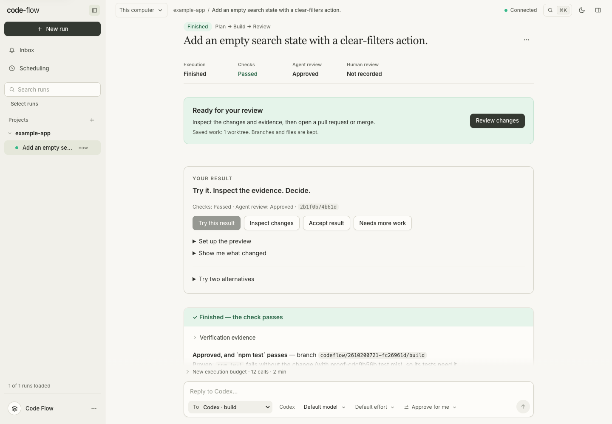
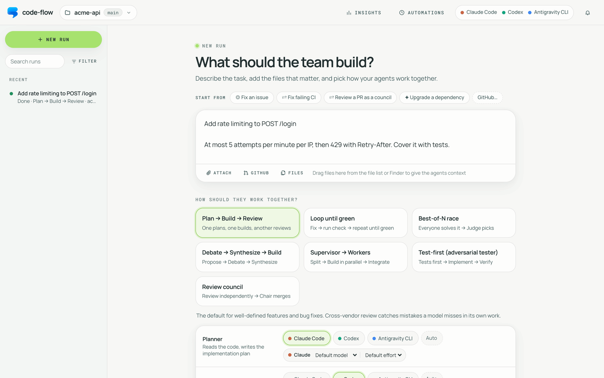

<p align="center">
  
</p>

<h1 align="center">code-flow</h1>

<p align="center">
  Run <b>Claude Code</b>, <b>Codex</b> and <b>Antigravity CLI</b> as one team of coding agents,<br>
  on the subscriptions you already pay for.
</p>

<p align="center">
  <a href="#quickstart">Quickstart</a> ·
  <a href="docs/patterns.md">Team patterns</a> ·
  <a href="docs/README.md">Docs</a> ·
  <a href="docs/security.md">Security</a>
</p>

<p align="center">
  <picture>
    <source media="(prefers-color-scheme: dark)" srcset="docs/images/run-dark.png">
    
  </picture>
</p>

---

You pick how the agents work together (plan → build → review, a race, a debate, a supervisor with workers…), assign an agent to each role, and watch them work live in your browser. An experimental, opt-in **Auto team** lets code-flow propose the team and workflow from your task instead. Agent work runs in Git worktrees on your own CLI logins. Results distinguish passing independent checks, failed checks, and finished work that remains unverified.

## Quickstart

You need Node 20+, git 2.38+ (for **Merge**), and at least one of [`claude`](https://docs.anthropic.com/en/docs/claude-code), [`codex`](https://github.com/openai/codex) or `agy` installed and signed in.

```bash
git clone https://github.com/midhunxavier/code-flow.git
cd code-flow
npm install
npm start
```

Open **http://localhost:4317**, choose a repository, describe the task, pick a team, and press **Start run** (⌘↵). Each result lands on a branch such as `codeflow/<run>/build`, ready to review, merge or open as a pull request. More in [Getting started](docs/getting-started.md).

## Highlights

The **Settings** page centralizes appearance, agent models, run defaults, notifications, automations, SSH VM connections, remote access, repository tools, Insights and workspace administration. Open it from the sidebar or with **⌘, / Ctrl+,**.

**Settings → Agents & models** also connects [OpenCode and other ACP-compatible CLIs](docs/acp-agents.md), with connection checks, discovered models and saved executable settings. These agents currently require Full access on the application host.

**Settings → Workspace** adds verification profiles and requirement mappings, code editing with three-way conflicts, selective checkpoint files/hunks, service launch profiles, coordinated repository changes and filtered tasks. Configuration, diagnostics, integrations and notifications live in Settings. The composer includes simple/advanced modes, named presets, task templates, readiness checks and settings provenance. Auto-team plans can be edited before approval; dispatch can be paused or prioritized. See the [implementation checklist and boundaries](docs/application-improvements.md), [API/client](docs/api.md), [verification](docs/verification.md), and [backup/maintenance](docs/maintenance.md).

Additional workflows include [selective task reruns](docs/task-reruns.md), [deferred starts](docs/deferred-runs.md), [context budgets](docs/context-inspection.md), [versioned conventions](docs/project-conventions.md), [reviewed commit reversions](docs/checkpoint-review.md), and a [local VS Code extension](integrations/vscode/README.md). The [review inbox](docs/review-inbox.md) groups questions, blocked work, failures and results across projects.

Use [shared project accounts](docs/shared-projects.md) for scoped human review,
[team collaboration](docs/team-collaboration.md) for a shared task board whose
work runs on each teammate's own computer,
[SSH projects](docs/ssh-projects.md) for a complete remote workspace,
[SSH workers](docs/remote-workers.md) for provisioned remote execution and
[coordinated changes](docs/coordinated-changes.md) for repository dependency
workflows. [GitLab/Bitbucket code workflows](docs/code-hosts.md), [GitHub review
threads](docs/github-review-threads.md), [architecture exploration](docs/architecture-explorer.md)
and [semantic memory claims](docs/memory-claims.md) provide bounded evidence for
review. [Filesystem policies](docs/filesystem-policy.md) and explicit trusted
[extensions](docs/extensions.md) document their execution boundaries.

- **A team, not one agent.** Seven patterns, from Plan → Build → Review to a Best-of-N race judged blind, with any agent in any role and a model and effort per role. Having a different vendor review or judge catches what a model misses in its own work.
- **Auto team (experimental, opt-in).** [Auto team](docs/auto-team.md) proposes members, tasks and acceptance criteria, asks for plan approval, then adapts within your limits. Members ask each other addressed questions and keep private, team and project memory. It is kept opt-in until its [measured evidence](docs/dynamic-teams-evaluation.md) supports more.
- **Your subscriptions, their official CLIs.** code-flow launches `claude`, `codex` and `agy` headless, as they ship. It never reads or stores credentials.
- **Your checkout stays untouched.** Every run works in git worktrees. Results are branches: review them line by line, send comments back to the agent, merge safely, or open a PR.
- **Done means the check passes, and proves something.** code-flow runs your test command itself after every change, feeds failures back, and flags edits that make tests pass without fixing anything. Then it runs the result's tests on the original code: at least one should fail there, or nothing shows the change works, and the agent is asked for a test that does. Reviewers show the bugs they report with a test that code-flow runs, so a false alarm doesn't cost a fix round.
- **A conversation, not a job queue.** Approve the plan before anyone builds, message the team while it works (straight into a running Codex turn), and reply after it finishes.
- **A side panel, like the apps you know.** Next to the work, and following what you open: side chats that work in the run's own worktree (ask, or change it), the run's changes, its files, real terminals (two at once, one above the other), a browser for the app it started where you pick or box what's wrong and send it to the agent with a snapshot (or a snapshot of any site, to draw boxes on), and your notes. A pin keeps it on one run; it can open in a window of its own.
- **Where the work lives, even when you're away.** Start from GitHub issues and PRs, fix failing CI, have a council review a PR, run on a schedule or from webhooks, and check in or take over from your phone. Built-in Tailscale detection gives your devices a private remote link and QR code.
- **Projects.** Runs are grouped by project with no setup: each repository gets one the first time you run in it. A project can span several repositories, and remembers the team you last used there.
- **Sweep the backlog.** Fix every open issue, every Dependabot PR with failing CI, or every security alert in one go: pick from the list, get one run each, approve the results from your inbox. Optionally every night, for new ones only.

## Pick a team

<picture>
  <source media="(prefers-color-scheme: dark)" srcset="docs/images/composer-dark.png">
  
</picture>

| Pattern | How the agents work | Reach for it when |
|---|---|---|
| **Auto team** | propose and approve the team → ready tasks, addressed questions and bounded revisions → integrate, check, review and repair | you want code-flow to choose the team and workflow |
| **Plan → Build → Review** | one plans, one builds, another vendor reviews against the task; code-flow runs the tests the reviewer shows bugs with; fixes until the check passes and nothing blocks | most features and bug fixes |
| **Loop until green** | fix → code-flow runs the check → repeat; hands over to the next vendor when stuck | "done" is a command: failing tests, a broken build |
| **Best-of-N race** | everyone solves it in parallel → a judge picks from anonymized diffs | the task is open-ended or risky |
| **Debate → Synthesize → Build** | anonymous proposals → critique rounds → one plan → build → review until approved | architecture, API design, big refactors |
| **Supervisor → Workers** | split into parallel subtasks → build on branches → integrate and review | larger tasks that split cleanly |
| **Test-first** | one writes failing tests, another makes them pass without touching them | behavior you can specify with tests |
| **Review council** | independent read-only reviews, bugs shown with tests code-flow runs → a chair ranks the worst confirmed first | reviewing a PR before merging |

How each pattern loops, checks and stops: [Team patterns, checks and limits](docs/patterns.md).

## How it uses your subscriptions

| Agent | Runs | Uses the login from |
|---|---|---|
| Claude Code | `claude -p` (stream-json) | `claude` (Pro/Max, or an API key) |
| Codex | `codex app-server`, or `codex exec` | `codex login` (ChatGPT plan, or an API key) |
| Antigravity | `agy -p` (stream-json), sandboxed | `agy` (Google AI Pro/Ultra) |

code-flow enforces the team's read-only steps itself, for every agent (a side chat's **Ask** reports changes instead of undoing them, since you may be working in the same worktree). It never merges on its own, and pushes only where you asked it to (a pull request you open, or one you told it to watch). This is the boundary each vendor draws for personal use: don't extend code-flow to read or reuse the CLIs' OAuth tokens. Checks run the agents' code on your machine, as your CI would, so use code-flow on repos you trust or run checks in Docker. Details in [Security](docs/security.md).

## Docs

- [Getting started](docs/getting-started.md): install, your first run, context, models, worktrees
- [Application improvement checklist](docs/application-improvements.md): all six priority packages, 14 product issues and 73 feature acceptance items
- [Expanded workspace workflows](docs/README.md): remote workers, shared reviews, coordinated repositories, semantic memory, extensions and verification
- [Team patterns, checks and limits](docs/patterns.md)
- [Auto team](docs/auto-team.md): dynamic workflows, messages, private/team/project memory, budgets and recovery
- [Runs](docs/runs.md): the run view, talking to a run, projects, the side panel, restarts and resume, Insights
- [GitHub, review and shipping](docs/github.md): review, merge, PRs, issues, follow-through
- [Automations and away mode](docs/automations.md): schedules, webhooks, the inbox, the phone view and full control from your phone
- [Configuration](docs/configuration.md): `.codeflow/config.json`, permissions, environment variables
- [Security, subscriptions and caveats](docs/security.md)
- [Architecture and development](docs/architecture.md): code layout, adding patterns and agents, tests

## Development

```bash
npm run dev        # http://localhost:4318 with fake agents: no real runs, no quota
npm test           # unit + workflow tests against fake CLIs
npm run test:e2e   # the real UI in headless Chrome
```

See [Architecture and development](docs/architecture.md).

## License

[MIT](LICENSE). The bundled font keeps its own licence: Inter under the [SIL Open Font License 1.1](ui/fonts/OFL-1.1.txt).
