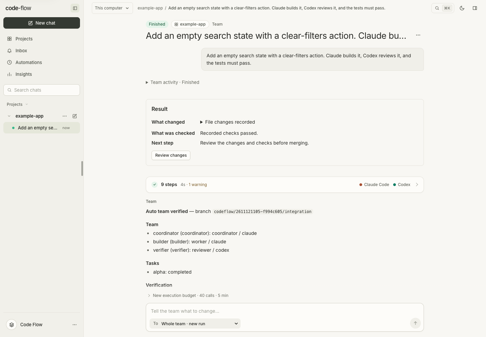

# Your agents. A clear path forward.

Code Flow brings coding CLIs into one workspace for planning, implementation, review and verification. Start with a small task, follow the evidence, and decide when the result is ready to ship.

## Try the preview

Start Code Flow locally and open it in your browser:

```bash
npx --yes --package=https://github.com/midhunxavier/code-flow/releases/download/v0.1.0-preview.14/midhunxavier-code-flow-0.1.0-preview.14.tgz codeflow
```

Use **Node.js 22.13+**, **Git 2.38+** and a supported coding CLI installed and signed in. Runs on macOS, Linux and Windows through **WSL2**. Keep the terminal open while you work; **Ctrl+C** stops the app.

Prefer a macOS app? Download **0.1.0-preview.14**:

- [Download for Apple Silicon (M1 or later)](https://github.com/midhunxavier/code-flow/releases/download/v0.1.0-preview.14/code-flow-0.1.0-preview.14-macos-arm64-unnotarized.dmg)
- [Download for Intel Mac](https://github.com/midhunxavier/code-flow/releases/download/v0.1.0-preview.14/code-flow-0.1.0-preview.14-macos-x64-unnotarized.dmg)

Requires **macOS 13+**. The app opens its own window and keeps agents running when you close it. Node is included; Git, a signed-in coding CLI and Chrome or Edge for the shared browser are still required. The DMGs are **unnotarized preview builds** and macOS may block them; use npm if blocked.

[Installation and setup](getting-started.md#install-and-run) · [Release notes and checksums](https://github.com/midhunxavier/code-flow/releases/tag/v0.1.0-preview.14)

<div class="cards">
<a href="getting-started.md"><strong>Start your first run ↗</strong><span>Install the app, connect a CLI and take a task from prompt to review.</span></a>
<a href="cli-conversational-teams.md"><strong>Use Code Flow in your terminal ↗</strong><span>Set up Claude Code or Codex and run a team from your conversation.</span></a>
<a href="patterns.md"><strong>Choose a workflow ↗</strong><span>Plan and build, test first, compare candidates or ask a team to investigate.</span></a>
<a href="runs.md"><strong>Find your way around ↗</strong><span>Follow agent activity, ask questions and open files, changes and terminals.</span></a>
<a href="verification.md"><strong>Review with confidence ↗</strong><span>Understand checks, review evidence and when a result is ready to ship.</span></a>
</div>

Read the story: [Describe the team. Code Flow builds the workflow.](https://midhunxavier.com/blog/code-flow/one-workspace-for-your-coding-agents/) · [Code Flow journal](https://midhunxavier.com/blog/code-flow/)

## From task to reviewed result

1. **Open a project.** Choose Open repository, confirm its project, then describe the outcome and add context.
2. **Choose the team.** Assign roles yourself or review a proposed Auto-team plan.
3. **Follow the work.** Answer questions, inspect changes and watch the checks.
4. **Review and ship.** Read the evidence before merging or opening a pull request.

<picture>
  <source media="(prefers-color-scheme: dark)" srcset="images/run-dark.png">
  
</picture>

*Captured from the local application with demo agents. See [screenshot provenance](documentation.md#screenshots).*

## Work with agents

- [Claude Code and Codex terminal setup](cli-conversational-teams.md) · [Team patterns](patterns.md) · [Auto team](auto-team.md) · [Project missions](project-teams.md)
- [Runs and the workspace](runs.md) · [Review inbox](review-inbox.md) · [Verification](verification.md)
- [GitHub and shipping](github.md) · [GitHub review threads](github-review-threads.md)
- [Selective task reruns](task-reruns.md) · [Deferred starts](deferred-runs.md)

## Make the workspace yours

- [Configuration](configuration.md) · [ACP agents](acp-agents.md) · [Context inspection](context-inspection.md)
- [Project conventions](project-conventions.md) · [Checkpoints and reversions](checkpoint-review.md)
- [Code intelligence](code-intelligence.md) · [Architecture explorer](architecture-explorer.md)
- [Project memory](memory-storage.md)
- [Coordinated repository changes](coordinated-changes.md)

## Connect and collaborate

- [Project integrations](project-integrations.md) · [Claude Desktop and Codex app](desktop-mcp.md)
- [Team collaboration](team-collaboration.md) · [Shared project accounts](shared-projects.md)
- [SSH projects](ssh-projects.md) · [Remote workers](remote-workers.md)
- [External sources](external-sources.md)
- [Automations and remote access](automations.md) · [Notifications](notifications.md)

## Operate safely

- [Security and execution boundaries](security.md) · [Filesystem policies](filesystem-policy.md)
- [Agent containers](agent-containers.md)
- [Dependency discovery](dependency-discovery.md) · [Backup and maintenance](maintenance.md)

## Build and extend

- [Architecture and development](architecture.md) · [API and CLI](api.md) · [Extensions](extensions.md)
- [Provider compatibility](provider-compatibility.md) · [Accessibility](accessibility.md)
- [Performance](performance.md) · [Run storage](run-storage.md)
- [Documentation and GitHub Pages](documentation.md)

## Engineering records

These documents record implementation decisions and evidence at a particular point in time. Use the guides above for current product instructions.

- [Worker permission verification](worker-permission-verification.md)

[Project README](../README.md) · [Getting started](getting-started.md)

Project collaboration lives in **More → Board** and **More → People**. Scheduled tasks, backlogs and missions live in **More → Automation**; configured Board and Automation tabs stay visible. Global Inbox and Scheduling cover the current computer.
