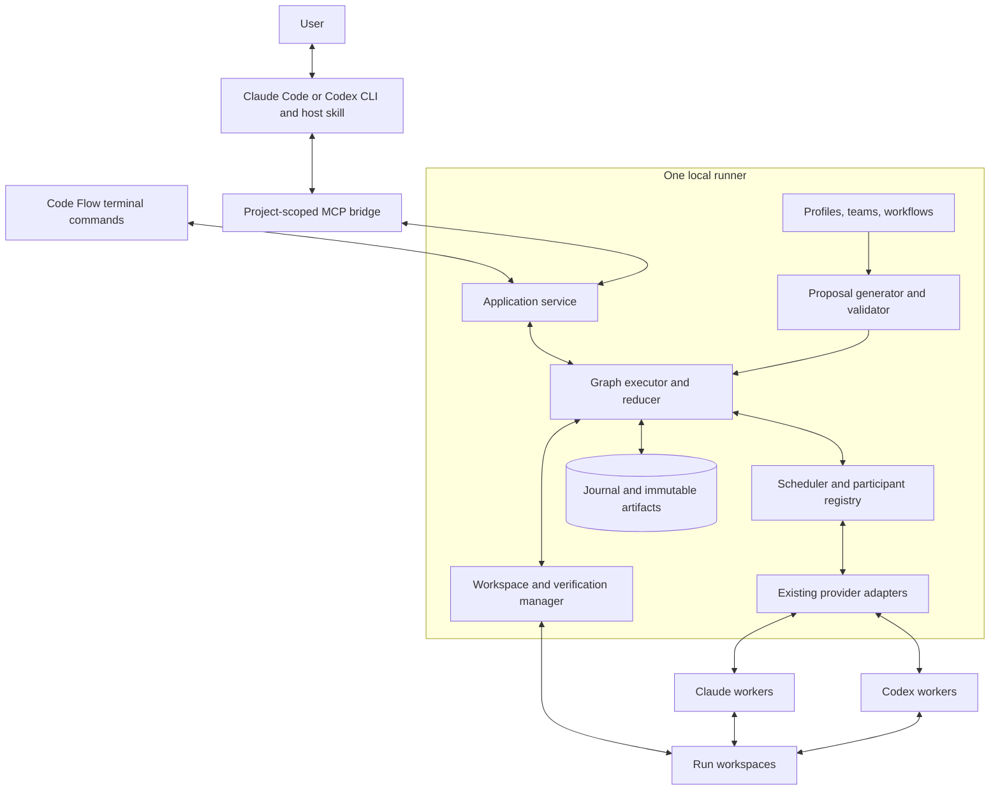

# System architecture

Status: proposed. [Index](README.md)

## Component and process boundaries

The skill explains the workflow to the host model and supplies selected context. The bridge transports requests. The application service validates commands and scopes authority. The graph executor is the sole authority for progression. Provider agents produce artifacts and recommendations; they do not independently transition the workflow.

## Deployment

Use the existing TypeScript/Node runtime and supported local environments. Package all new code in the existing distributable after compatibility testing. The repository currently declares Node 22.13+; do not promise a different support floor without testing the full package.

One runner owns each canonical Code Flow state directory. Launch under the user's account with an owner lock, authenticated discovery, and a startup handshake. CLI clients first connect to that owner. If none exists, start a headless owner. If the web application already owns it, reuse that process through the same service interface. An incompatible running owner produces an actionable version error; do not kill it or start a competing owner.

A local IPC transport is preferred. Authenticated loopback may be used where needed, preserving existing Host/Origin and connection checks. The project MCP configuration contains the executable and arguments, never an owner token. The bridge obtains a short-lived, project-scoped connection through local bootstrap. Stdout is reserved for MCP; logs go to stderr or the runner's local log.

The MCP bridge can exit without owning the worker lifecycle. Accepted managed work may continue under the runner when the proposal permits it. A host-owned step waits when the host disconnects.

## Proposed modules

| Module | Responsibility |
| --- | --- |
| `src/cli-teams/model.ts` | Versioned public/domain types and identifier rules |
| `src/cli-teams/validation.ts` | Definitions, capability compatibility, graph and policy validation |
| `src/cli-teams/service.ts` | Shared command API; scope, revisions, idempotency |
| `src/cli-teams/proposals.ts` | Task-to-proposal resolution and immutable accepted snapshots |
| `src/cli-teams/compiler.ts` | Expand role fan-out and bounded loops into deterministic step instances |
| `src/cli-teams/reducer.ts` | Pure transitions from committed journal records |
| `src/cli-teams/executor.ts` | Admission, dispatch, outcomes, gates, recovery |
| `src/cli-teams/participants.ts` | Current-session bindings and managed participants |
| `src/cli-teams/artifacts.ts` | Immutable artifact storage and typed references |
| `src/cli-teams/mcp.ts` | Public tool definitions and protocol handlers |
| `src/cli-teams/runtime.ts` | Headless startup, owner lock, connection bootstrap |
| `src/cli-teams/install.ts` | Project setup, managed config entries, uninstall |

Names are implementation targets, not files already present. Keep modules small and dependency-directed: transports depend on service; service depends on domain/execution; domain does not import UI, HTTP, or vendor process code.

## Existing foundations to reuse

| Existing file | Reuse or adaptation |
| --- | --- |
| [engine.ts](../../src/engine.ts) | RunManager ownership, TeamContext, durable operations, existing run controls |
| [store.ts](../../src/store.ts) | Durable append and recovery primitives |
| [team-scheduler.ts](../../src/team-scheduler.ts) | Bounded dispatch and recorded completion batches |
| [adapters/types.ts](../../src/adapters/types.ts) | Provider execution, events, settings, errors, sessions |
| [adapters/codex.ts](../../src/adapters/codex.ts) | Codex transport selection and structured output |
| [adapters/claude.ts](../../src/adapters/claude.ts) | Claude process and interactive stream integration |
| [git.ts](../../src/git.ts) | Repository identity, locks, worktrees, snapshots |
| [run-permissions.ts](../../src/run-permissions.ts) | Effective permission constraints |
| [team-template-store.ts](../../src/team-template-store.ts) | Immutable template versions and compare-and-swap saves |
| [patterns/pipeline.ts](../../src/patterns/pipeline.ts) | Build/check/review semantics and evidence handling |
| [patterns/debate.ts](../../src/patterns/debate.ts) | Independent proposals and synthesis behavior |

The existing internal [agent tool client](../../src/agent-tool-client.mjs) requires a parent-issued turn capability. It is not the public host connector. Reuse tested transport concepts, but create a separately scoped public interface.

## Execution integration

Add a distinct versioned graph-backed run type/pattern under RunManager. Existing procedural patterns remain supported. The new graph runner can reuse verified task/check helpers without treating a legacy pattern's final summary as structured graph evidence.

All graph scheduling goes through the graph executor. Existing scheduler code may provide concurrency primitives, but may not make competing workflow decisions. Similarly, the web API and MCP API must submit commands to the same run owner.

The new graph journal is the authoritative source for graph transitions and control receipts. Existing run events remain UI/history projections derived from those committed transitions. See [durability](09-durability-and-recovery.md) for the precise single-writer rule.

## Context and result path

Host request -> explicit context manifest -> accepted run snapshot -> role-specific assignment -> typed artifact -> validated gate -> final result artifact -> original host conversation.

No provider receives an entire other provider conversation by default. Large logs and source content are referenced and fetched selectively. The final result must contain the deliverable and evidence references; a path alone is insufficient for a short plan or proposal requested in chat.

## Scaling boundary

Local concurrency is bounded per machine and provider, with fair scheduling across projects. No database or message broker is required for V1. A later remote participant implements the same assignment/result contract, but requires a separate transport and security design. Do not add remote endpoint flags to the local bridge prematurely.
