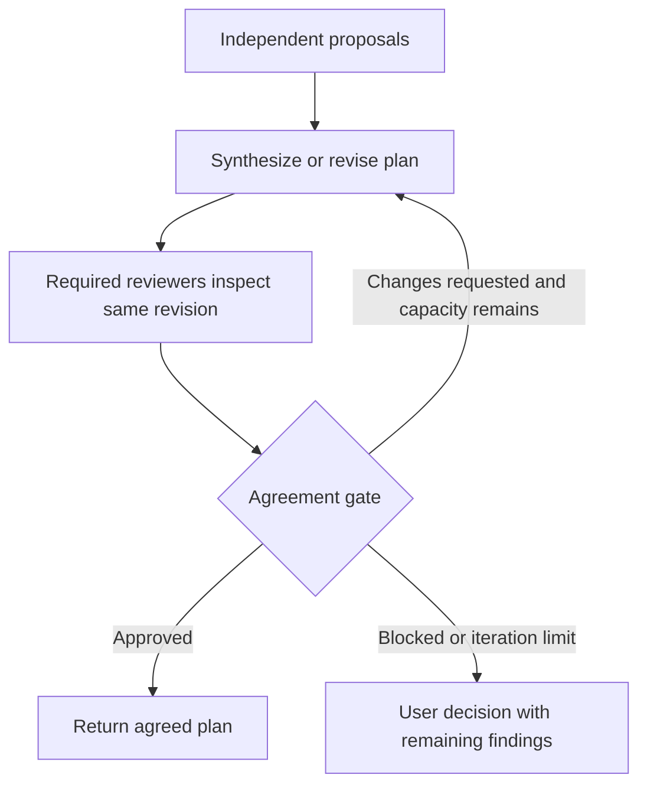

# Workflow graph and execution semantics

Status: proposed. [Index](README.md)

## Graph grammar

A workflow is a versioned declarative graph. Provider names belong in team bindings, not graph control logic. V1 supports `task`, `parallel`, `join`, `gate`, `loop`, `user_decision`, and `finish`. Unknown node types are rejected.

```ts
type Edge = { from: string; to: string; on?: string };
type InputBinding =
  | { from: "input"; name: string }
  | { from: "node"; node: string; output: string }
  | { from: "state"; name: string }; // only inside a loop

type TaskBase = {
  id: string;
  type: "task";
  inputs: Record<string, InputBinding>;
  output: { name: string; kind: string };
};
type TaskNode = TaskBase & (
  | {
      executor: "participant";
      role: string;
      operation: "propose" | "revise_proposal" | "synthesize" |
                 "review_plan" | "implement" | "repair" | "review_code";
    }
  | {
      executor: "engine";
      operation: "verify" | "capture_snapshot";
      profile?: "accepted"; // required for verify; never a caller shell expression
    }
);
```

The schema restricts operations and artifact kinds to registered contracts. Workflow authors cannot insert JavaScript, evaluate arbitrary expressions, or define shell commands in a decision expression. Verification uses an accepted check profile through a registered engine operation.

A participant `task` requires one eligible participant. An engine `task` has no provider role and invokes only the registered snapshot/verification implementation. `parallel` contains a task template and a `forEachRole` binding. It resolves the accepted role roster once, starts one child per participant subject to concurrency limits, and exports an ordered collection. `joinPolicy: all` is the only V1 parallel join policy. Failures and missing children are represented; they do not become empty successful results. A standalone `join` combines explicit upstream branches when a workflow needs that shape.

A parallel node declares an output with `collection: true`; each child publishes the singular artifact kind and the parent exposes an ordered array of references. Local node references resolve before references to earlier enclosing nodes; shadowing an enclosing node ID is rejected. A loop may read prior outer-node outputs but cannot reference a future outer node.

The role roster, order, and logical child IDs are saved before fan-out. Provider replacement creates an explicit assignment revision, not an extra vote.

## Bounded loops

Arbitrary back edges are forbidden. A `loop` node owns an acyclic body graph, declared state slots, initial bindings, next-state bindings, a designated gate node, and a maximum iteration count. V1 allows a loop containing tasks, parallel groups, joins, and a gate; nested loops are deferred.

```ts
type LoopNode = {
  id: string;
  type: "loop";
  maxIterations: number;
  initial: Record<string, InputBinding | null>;
  body: { nodes: unknown[]; edges: Edge[] };
  gate: string;
  next: Record<string, { node: string; output: string }>;
  exports: Record<string, { node: string; output: string }>;
  onLimit: "wait_for_user";
};
```

Each iteration receives immutable workflow inputs and the previous iteration's declared state. The body must export the required next-state and output values. Gate outcome `approved` exits successfully; `changes_requested` starts another iteration if budget and iteration allowance remain; `blocked` waits for an explicit decision. Operational failures are handled by step recovery, not converted into model disagreement.

The review count is the count of completed review iterations, including the first review. Three iterations therefore means three reviews total, not one initial review plus three repairs. Retries of a failed transport use a new attempt under the same step and consume invocation budget, but do not create another vote or revision iteration.

No new iteration is admitted unless the minimum remaining stage work fits the invocation reservation. On the last rejected iteration, preserve the current plan and findings; do not perform another synthesis that nobody will review.

## Plan agreement graph



Cross-review is an optional stage before synthesis. For small teams, the compiler can assign each planner the other proposals. For larger teams, use the accepted review panel. Do not silently expand an N-person team into N×(N−1) review work.

## Gate policies

V1 plan agreement requires unanimous approval from the explicitly required reviewer set. Every verdict must target the same plan hash/revision. Required reviewers are frozen for that iteration. Missing, cancelled, unavailable, malformed, or stale votes are not approvals. Votes from an ineligible participant are rejected.

A `build_complete` gate requires approvals on the delivered code snapshot, all required verification gates passed, and no open blocking findings. A model's vote cannot override failed required verification. Optional suggestions remain visible without creating another repair cycle.

Majority, quorum, weighted votes, and automatic override are schema-reserved future features, rejected by V1. A user may revise the accepted completion policy explicitly; the resulting report must disclose the revision rather than claim unanimous agreement.

## Branches, joins, and finishing

An edge without `on` requires successful completion of its source. An edge with `on` is active only when its gate emits that registered outcome. The compiler checks that every possible gate outcome has a destination or an explicit terminal/wait rule. Unselected branches become `skipped` and cannot dispatch.

A standalone join has explicit source bindings and `policy: all_active`: it waits for every selected branch and preserves failure/blocked outcomes rather than treating them as missing optional data. The compiler rejects ambiguous mixtures of alternative branches and ordinary all-input dependencies. A parallel group's `joinPolicy: all` always requires every accepted participant; it is not an alternative-branch join.

The `repair_required` gate is available outside loops for review/fix routing. It emits `repair_required`, `no_repair`, or `blocked` from validated findings and the accepted `allowFixes` flag. The no-repair path does not authorize skipping required verification. A `user_decision` node presents a declared question/options and waits for a recorded answer; agent findings cannot answer it on behalf of the user.

A finish node builds an engine-authored result artifact. `agreed_plan` requires the matching approved agreement decision; `verified_changes` requires a matching approved build gate and verification; `review_complete` requires all requested review artifacts but does not imply code approval. Unsupported finish outcomes are rejected. This prevents a custom graph from bypassing gates merely by naming its final result successful.

## Compilation and scheduling

1. Validate definitions, references, cardinalities, capabilities, workspace requirements, permissions, and total expansion bounds.
2. Resolve team/profile versions and compile a deterministic execution plan.
3. Save the configuration hash and all initial participant bindings.
4. Mark steps ready only when required typed input artifacts are durable and current.
5. Acquire provider capacity and workspace ownership, reserve budget, and save dispatch intent.
6. Dispatch or expose a host claim, depending on the participant binding.
7. Validate and persist the result; derive downstream readiness from committed records.
8. Evaluate gates in ordinary code. Only artifact production is delegated to models.

Stable step IDs include run ID, node path, iteration path, and participant ID. Scheduling order may vary for independent work, but persisted completion batches and sorted participant IDs make recovery deterministic.

## Validation rules

- Node and role IDs are unique within their scopes; edges reference existing nodes.
- Graphs have explicit inputs, entry nodes, and reachable finish/wait outcomes.
- Ordinary graphs and loop bodies are acyclic.
- Output types match input contracts; optional/null loop state is declared explicitly.
- A gate's target and reviewers are well-defined; it cannot approve an undefined or different artifact.
- Each finish output refers to a reachable artifact.
- Write stages serialize per workspace; V1 rejects concurrent writer expansions.
- A role's provider independence requirements are satisfiable or the proposal is rejected.
- Conditions select registered outcome labels only; no arbitrary expression interpreter.
- Maximum nodes, participants, loops, artifact sizes, and total expanded steps are checked before admission.

Initial bounds: 8 participants/run, 64 definition nodes, 256 expanded step instances, 2 concurrent managed workers by default, up to 4 by accepted configuration, and at most 5 iterations per loop. These are deliberate V1 product bounds, not provider capabilities. Existing run call/time defaults remain ceilings selected during proposal resolution; limits are not spending targets.

## Configuration changes during a run

Steering text is recorded as an instruction artifact. If it changes task requirements, a target plan, roles, providers, graph structure, permissions, or completion criteria, generate a proposal revision at a safe boundary. Invalidate affected descendants and their evidence. V1 may conservatively create a linked continuation run from preserved artifacts rather than mutate an active graph in place. Budget increases always need new user authorization.

For minor implementation clarification within the accepted scope, attach the instruction to the next relevant assignment and record its provenance. Do not replay completed unaffected steps.
