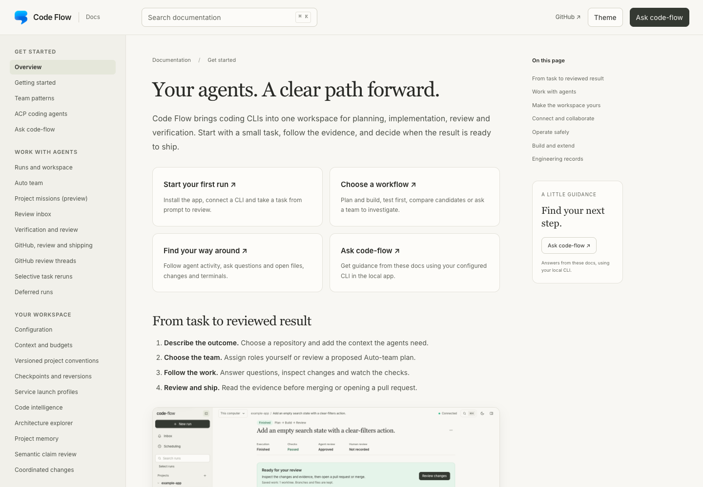

# Documentation and GitHub Pages

The Markdown files in this repository are the source for both the local help library and a static documentation site. The site uses the same warm paper surfaces, olive controls, mint accents, Inter fonts, Georgia headings and light/dark theme tokens as the application.

<picture>
  <source media="(prefers-color-scheme: dark)" srcset="images/docs-dark.png">
  
</picture>

## Read locally

`npm start` builds the documentation with the app. Open **Application menu → Help & documentation** or visit `/docs/` on the application server. Search and navigation work locally; **Ask code-flow** uses your installed CLI after owner authentication.

To preview only the static site:

```bash
npm ci
npm run docs:preview
```

Open [127.0.0.1:4319](http://127.0.0.1:4319). This preview intentionally behaves like GitHub Pages, so the CLI assistant is unavailable. Restart the preview after editing Markdown or site assets.

## Publish to GitHub Pages

1. Push this repository to GitHub with `main` as the publishing branch. If your default branch differs, update `.github/workflows/docs.yml` accordingly.
2. Open the repository's **Settings → Pages** and choose **GitHub Actions** as the build source.
3. Run the **Documentation** workflow manually, or push a documentation change to `main`.
4. Open the deployment URL reported by the workflow's `github-pages` environment.

The upstream site is [Code Flow documentation](https://midhunxavier.github.io/code-flow/). GitHub may redirect this address to the owner’s configured Pages domain. Forks use their own owner and repository names. Adding the workflow alone does not activate or publish a site.

The workflow builds `dist/docs`, runs the documentation tests, uploads the Pages artifact and deploys it. Pull requests build and test without deploying. All site assets and links are relative, so project subpaths and custom domains work without a base-URL setting. There are no CDN fonts, analytics scripts or client framework dependencies.

For another static host, build and upload the contents of `dist/docs`:

```bash
npm run build:docs
```

## Edit a guide

1. Edit its Markdown file under `docs/`. Keep task instructions first, followed by limits and API details.
2. Add new guides to `docs/site/navigation.json` and link them from the docs index.
3. Link to other guides using relative `.md` paths. The builder rewrites those links to `.html` and preserves heading anchors.
4. Run `npm run build:docs` and `npm run test:docs`.
5. Preview desktop and mobile layouts in both themes when changing presentation.

The generated `public/docs` and `dist/docs` directories are ignored by Git. Commit the source Markdown, site assets and screenshots instead. `npm run build` packages the docs with remote host bundles too. App development builds the docs at startup; rerun `npm run build:docs` after changing guide content during a dev session.

## Screenshots

The README screenshots are captured from the real application UI with deterministic fake CLIs and a disposable example repository. They are demonstration data, not live customer work or evidence of provider performance.

Run the reproducible capture script with Chrome installed:

```bash
npm run screenshots:docs
```

It builds the app, starts a private fixture server, creates a sample run and captures the composer, run and transcript in light and dark mode. It also captures documentation in both themes. Screenshots are written to `docs/images`; transient browser artifacts belong in `output/playwright`. The fixture server and temporary repository are removed afterward. The script does not use real provider quota.

Keep images focused, use descriptive alternative text, and label demo data wherever a screenshot could be mistaken for verification evidence. Re-capture when navigation or the run layout changes.

## Implementation

| File | Responsibility |
| --- | --- |
| `scripts/build-docs.mjs` | Markdown rendering, links, navigation, table of contents and search corpus |
| `docs/site/navigation.json` | Guide groups and reading order |
| `docs/site/style.css` | Documentation layout, using app theme tokens and fonts |
| `docs/site/app.js` | Search, theme, code copying and help dialog |
| `src/docs-help.ts` | Static local serving, bounded retrieval and CLI help requests |
| `.github/workflows/docs.yml` | Build validation and Pages deployment |

[Documentation library](README.md) · [Architecture](architecture.md) · [Ask code-flow](help.md)
