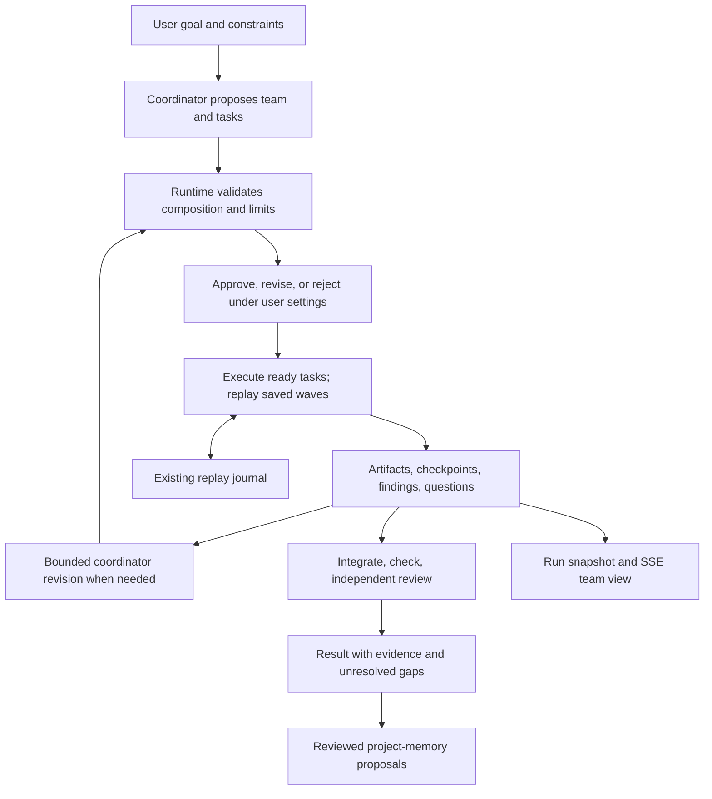

# Dynamic teams, workflows, messaging, and memory

Status: implementation complete, revision 3. P0–P8 are implemented, including the previously conditional asynchronous scheduler and live-tool bridge. Auto remains opt-in under an explicit evaluation/rollout gate. See the [user guide](auto-team.md) and [measured evidence and rollout decision](dynamic-teams-evaluation.md).

Prepared 17 October 2026 against repository revision `ee246c7`. Revised against [Review 0](dynamic-teams-plan-review-0.md). Phase numbers below supersede the original ordering; the review remains a record of the original proposal.

Implementation is based on `main` at `8cb3641`, including its checked review findings and fail-to-pass proofs. Sections describing the original repository baseline below are historical design context, not claims about the updated code.

### Implementation status

| Work package | Delivered |
|---|---|
| P0 + Slice 0 | Opt-in Auto team, strict provider-compatible schemas, composition rules, approval, independent members, capability inventory, verification and launch budgets |
| P1 | Fail-closed fsynced journal, incomplete-tail recovery, deterministic completion/command replay, crash recovery, SSE restart reconciliation and measured replay bytes/time |
| P2 | Member/session/settings/usage identity, isolated writers, typed knowledge/artifact/completion dependencies, integration SHA inputs, stale-attempt rejection and bounded replacement |
| P3 | Private checkpoints, team proposals/contracts/findings, attributable project retrieval/promotion, inspector/CAS/retention/deletion, exact-revision relevance feedback and fixture/real-run retrieval measurements |
| P4 | Event-driven ready-work dispatch, atomic mailbox commands/receipts, request/wait/deadline state, idle answer turns, immediate/duplicate replies, cycle/unavailable escalation and replayed completion batches |
| P5 | Bounded expansion/retirement, safe handovers, compact coordinator checkpoints, declarative reusable subplans, affected-evidence invalidation, shared Supervisor decomposition/integration primitives and saved-wave compatibility |
| P6 | Scoped Claude/Codex MCP bridge, expiring member credentials, server-derived authority, durable inbox/memory tools, agent-origin live steering with queued fallback, explicit capability/nested-agent limits and real CLI smoke checks |
| P7 | Composer and workflow/inbox/context/memory views, approval and blockers, phone/automation integration, bounded follow-ups, explicit in-flight goal revisions, parent-context/source-trust retention and new-run disable switch |
| P8 | Fault/compatibility/browser tests, isolated fake and real paired evaluation runner, immutable versioned reports, approval/memory/replay/coordination measurements and an audited evidence-gated rollout decision |

The user's instruction to implement all remaining phases explicitly opened P4/P6 on 17 October 2026. Their original sampling gates remain below as historical decision criteria; the implementation does not claim that a 20-run/100-turn latency experiment has been completed. The reproducible no-barrier fixture validates the scheduling benefit. Real model quality, overhead and default rollout are assessed separately in the evidence report.

The storage decision is to retain the single-writer JSONL journal. One durable command envelope contains question/wait effects and its receipt; replayed drain batches and completion order provide the required logical atomicity. Disposable projections, rather than an outbox, database, leases or a new runtime baseline, remain sufficient. Node 20/22 CI configuration is preserved.

The rollout decision is **experimental/opt-in**. Implementing the rollout gate does not force promotion: the initial real comparisons expose bounded-time failures and coordination overhead, so there is no evidence for making Auto the default. Unknown vendor-native usage remains unknown; unsupported adapters retain their structured-outcome path.

## 1. Product promise and delivery decision

> Give code-flow a task; it assembles an appropriate team from your available agents, coordinates their work, and delivers a verified result with reusable project knowledge.

The user should not need to choose an orchestration pattern. A coordinator investigates the goal, proposes members and a workflow, gets plan approval according to the user's settings, and adapts the work as evidence arrives. Small tasks should produce small teams. Success means satisfying the task with evidence, not creating more agents.

**Build Slice 0 before a storage migration, a new scheduler, or a mailbox service.** It is an opt-in **Auto team** pattern on the existing engine: coordinator planning, plan approval, dependency waves, addressed questions in structured outcomes, bounded revisions, and independent verification. Minimal private checkpoints and team contracts are part of that slice. Reusable project memory follows execution data in Phase 3; Slice 0 does not claim to deliver that part of the promise yet.

The long-term architecture stays the same: code-flow owns member identities, workflows, communication, and three memory scopes across official vendor CLI sessions. The delivery order changes so real runs determine how much infrastructure is needed.

## 2. What we reuse, and what actually needs changing

| Foundation | Existing behavior | Planned extension |
|---|---|---|
| `src/patterns/supervisor.ts` | Read-only decomposition, contracts, approval, parallel workers, integration and review | Generate individual members, execute dependency waves, revise assignments and route questions |
| `TeamContext.decide()` / `remember()` | Completed decisions and operations replay from the journal | Stable task/wave/attempt identities and deterministic application of recorded revisions |
| `src/store.ts` | Ordered JSONL writes, a synced replay journal, one-server lock | Surface control-write failures; add batch records/snapshots only where required |
| `TeamContext.ask()` and adapters | Official CLIs, sessions, structured output, retries, cancellation | Member identity and validated member-specific settings, without replacing adapters |
| `src/routing.ts`, `src/stats.ts` | Availability/quota signals and repository outcome ranking | Apply these inputs to a validated team composition policy; allow repeated providers |
| `src/git.ts`, engine worktree/check methods | Isolated worktrees, replay-aware commits and checks | Dependency inputs pinned to integration commits, explicit verification coverage |
| Notes and Codex steering | User-origin notes addressed by provider; some live input | Member addressing and agent-origin messages kept separate from user instructions |
| `src/context.ts`, `src/learnings.ts`, `src/projects.ts` | Conventions, attachments, recurring findings, project membership | Scoped checkpoints and attributable memory, with enforced promotion rules |
| Run snapshot, SSE and composer | Existing pattern selection, approvals and live steps | Auto team choice, roster/tasks/questions and coordination metrics from Slice 0 |

### Recovery correction

`remember()` already journals the result of `decide()`'s underlying agent call. A deterministic pattern replays completed coordinator decisions; it does not ask the model to invent its team again. Dynamic planning therefore does not, by itself, require a new recovery model.

`journalEntry()` calls `appendLine(..., { sync: true })`, and the journal write is awaited before the pattern continues. Ordinary event-log writes do not fsync each event. However, **both paths currently use `appendLine()`, which catches write errors, increments `writeHealth`, and resolves**. The journal has a durability mechanism but does not fail closed when that mechanism fails. Slice 0 should add narrowly scoped error propagation for authoritative journal writes and update the in-memory journal only after successful persistence. This is a small hardening change, not a database migration.

Replay remains appropriate while execution is a bounded sequence of waves and recorded outcomes. Long-lived mailboxes, asynchronous wakeups outside those waves, or expensive replay could justify another driver later. Phase 4 has an evidence gate for that decision.

### Compatibility facts

- `AgentId` is a provider (`claude`, `codex`, `agy`), not an individual worker. Existing role routing deduplicates providers within a role; dynamic member IDs must bypass that deduplication without changing manual-pattern semantics.
- Node 20 is supported and in CI. Preserve it for this plan. SQLite is not a prerequisite; any later driver proposal must explicitly address Node, packaging and platform support.
- Resume currently gives a fresh step/time budget. Slice 0 preserves this documented behavior for an explicit user resume, while reporting lifetime usage separately. A replayed wave never resets its recorded wave/repair counters. Internal retries do not silently grant a fresh budget.
- There are four `findPattern()` call sites in engine/server code. Register `auto-team` normally. Older versions already reject an unknown pattern on resume; no new execution-mode framework is necessary for Slice 0. Future incompatible plan schemas need an explicit version check.
- SSE reconnect cursors currently apply within one server start. Improving cross-restart reconnect helps legacy runs too and can ship independently.

## 3. Invariants to keep

1. **Agents propose; the runtime validates and verifies.** A coordinator cannot delete user requirements, increase its budget, raise trust, or authorize publishing through a plan revision.
2. **Individual identity is independent of provider.** Two Codex members have different IDs, context, sessions, assignments and usage attribution.
3. **One active turn per member/session, one writer per worktree.** Reassignment reconciles the previous process before starting another writer. Never pass a session ID between providers.
4. **Persist accepted control state before acting on it.** A failed authoritative write stops new dependent dispatch. UI projections are not a second source of truth.
5. **Replay completed decisions.** Stable identities, recorded inputs and deterministic ordering reproduce accepted plans. Current clock/quota/filesystem state must not silently change an already-recorded branch during replay.
6. **Messages are not user authorization.** Sender identity and source trust come from code-flow. Ordinary output text is never parsed as executable control commands.
7. **Waiting releases capacity.** A member needing information ends its turn with a checkpoint; it does not occupy a CLI slot waiting for another member.
8. **Verification applies to evidence.** Unknown or unrunnable is not a pass. A gap must never become success merely because all runnable tasks ended.
9. **Project memory has an enforced trust boundary.** A locked-down or otherwise untrusted source cannot automatically create instructions for future runs.
10. **No exactly-once model-execution claim.** A process can finish external work before its result is stored. Recovery reconciles artifacts and uses idempotent logical operations; transport or execution can repeat.

## 4. Define “appropriate team” before implementation

These are proposed, testable defaults for the opt-in experiment. Record them in the plan and fixtures, rather than leaving them to a coordinator prompt.

| Rule | Initial policy and validation |
|---|---|
| User constraints | Preserve provider/model pins, trust, allowed paths, check commands and budgets. Reject revisions that exceed them. |
| Availability | Choose installed, usable providers. Reuse `exhausted()` signals, including near-full windows and recent authentication failures. Unknown quota is labeled unknown. |
| All providers exhausted | Auto team pauses or reports a routing blocker; it does not silently spend against a known exhausted provider. This is stricter than current `resolveAuto()`, which can fall back to exhausted candidates with a warning. Explicit user choices remain visible. |
| Provider ranking | Use existing repository pass-history ranking among eligible providers, with its existing fallback order. Treat it as a prior with limited evidence, not a universal skill score. |
| Small teams | Start with a coordinator, one worker and an independent reviewer. Allow a second worker only for tasks whose ownership/dependencies permit useful parallel work, with a stated reason. A read-only task may use the coordinator as its investigator. |
| Size bounds | Default maximum four active members including coordinator/reviewer, twelve tasks across accepted revisions, four execution waves, and two repair rounds. Reject expansion beyond the approved limits. These are experiment settings, not measured optima. |
| Review independence | Reviewer is a separate member/session, read-only, and cannot approve work it authored. Prefer a different provider from the primary author; record any same-provider fallback. If the user's policy requires different providers and none is eligible, report the blocker. |
| Same-provider workers | Allowed when useful. Member IDs, not provider strings or display names, identify tasks and communications. |
| Models and effort | Choose from the supplied supported/configured settings or the provider default. Do not invent a model name. Explicit user settings win. |
| Workflow validity | Unique IDs, existing owners, acyclic dependencies, bounded expansion, acceptance criteria for required tasks, and requirement coverage. Reject silent requirement removal. |
| Ownership | Concurrent tasks need compatible declared ownership; actual changed paths are checked before integration. Shared-file work is ordered or assigned to an integration task. |
| Task kind | Implementation requires applicable checks/review; investigation/design can succeed with an accepted evidence-bearing artifact and no code changes. |

The first plan includes stable requirement IDs, editable acceptance criteria, members and rationale, provider/model/effort settings, tasks/dependencies, ownership, contracts, verification requirements, and a turn estimate with a hard cap. Estimates must distinguish known bounds from uncertain token use.

### Approval and revision policy

Use the existing `ctx.approve("plan", ...)` checkpoint before dispatching workers. Show the proposed team, settings, tasks, acceptance criteria, constraints and estimated turns. Approve, revise and reject must all work. Approval pauses the run clock and its recorded answer replays on resume.

For a newly selected Auto team, default plan approval on; honor explicit saved choices and existing automation authorization. The initial planning call itself consumes quota, which the composer should make clear. When approval is disabled, still record the validated plan and why no interactive checkpoint was required.

Routine reassignment or repair within the approved scope can proceed and remains visible. A user-requested goal change produces a new requirement/plan revision and goes through the same configured checkpoint before affected new work. Any proposal exceeding authorized providers, spending limits, permissions or scope requires the relevant user decision; the coordinator cannot approve that increase. Stop or finish the current turn safely before changing its inputs.

### Coordination budget and measurements

Use actual CLI invocations, including schema repair and retry invocations, for coordination accounting. Existing logical `agentSteps` alone may not expose every underlying retry; add attribution at the launch boundary. Report steps, input/output/cache tokens, elapsed time, and provider-reported API-equivalent cost separately. Missing token/cost reports are unknown, not zero, and API-equivalent cost is not a subscription bill.

For the initial experiment, with an approved invocation budget `B >= 4`, reserve at most `min(4, floor(B / 4))` coordinator invocations. Count initial planning, approval-driven replanning and wave revisions against this ceiling. Enforce the total execution limits too; reserve room for required review and checks before admitting more work. If the budget cannot fund a valid plan, explain that before worker dispatch.

This caps coordination at 25% of the *authorized invocation budget*, not necessarily 25% of actual spend. A tiny run may use one coordinator turn out of three total turns. Report the observed fraction honestly. Use 25% observed coordinator turns on multi-worker runs as an initial evaluation target, not an asserted result or a runtime rule that could deadlock startup.

At the coordination ceiling, run only already-authorized ready work and verification that fit the remaining budget. Do not create additional tasks or keep calling the coordinator. Return explicit gaps if another planning decision is required. User resume retains today's fresh-budget behavior; expose both the new allocation and cumulative spend. Automatic crash recovery must not be used as a budget-reset mechanism.

## 5. Slice 0 — demonstrate the promise on the existing engine

**Outcome:** a user chooses Auto team, describes a task, approves the generated team/plan, and sees it execute and adapt without choosing a team pattern. This is the first user-visible milestone.

Implement Slice 0 alongside the small Phase 0 contract work. It does not wait for Phases 1–4.

### 5.1 Plan and replay

Add `src/patterns/auto-team.ts`, register `auto-team`, and use `TeamContext.decide()` with `TEAM_PLAN_SCHEMA`. Reuse supervisor planning, approval, worktree, integration and review behavior where practical.

Journal the planning inventory and relevant policy inputs before using them: provider availability/quota observations, configured settings, task limits and base commit. Validate completed decisions against their recorded input revision on replay; refresh availability at a new dispatch boundary through a new recorded observation. Do not recompute historical routing from today's quota or clock.

Use stable identities such as `plan:0`, `wave:2`, and `task:api:attempt:1`. Create all task/attempt identities and a sorted wave membership before parallel dispatch. Keep unrelated operations out of those identity counters. Reconstruct the roster, sessions and questions from recorded outcomes; an `onStart` callback that does not run during replay cannot be the sole source of that state.

### 5.2 Individual members and workspace handling

Store a small member map within the pattern's replayable state. Add an optional `memberId` to step/ask metadata and a validated per-call settings override so two members on the same provider can actually use different configured models. Preserve existing role/provider settings as the fallback for legacy patterns.

Associate each member with its current session lineage and workspace. Resume the same session only with its compatible provider and workspace. A new task in a different worktree gets a fresh session plus a portable checkpoint; do not assume a provider can safely resume a conversation in a different directory. Keep one active assignment per member.

Create a task's worktree from the recorded integration HEAD containing its required upstream artifacts. A yielded task keeps its existing worktree and checkpoint. Reconcile any newer dependency commits only while that task is idle, then record the new input revision. A message describing code does not make that code available in another worktree.

### 5.3 Execute dependency waves

Select ready tasks deterministically, respecting dependencies, ownership, available members and global slots. Use `ctx.parallel()` and `allowFailure: true` for expected worker failures; retain run-wide stopping for unsafe process/storage/workspace failures.

Each turn produces a validated `TASK_OUTCOME_SCHEMA` with:

- task/member/attempt identity and `submitted`, `needs_info`, or `failed` status;
- an observable checkpoint, artifact references and unresolved requirements;
- addressed questions/replies, contract proposals and evidence-bearing findings;
- the input/contract revisions the result relied on.

A `needs_info` result ends the CLI turn and releases its slot. Preserve partial edits for that task; do not merge them as a completed dependency. Integrate submitted artifacts serially, handle conflicts through existing controlled repair, and run applicable checks. Downstream work starts only once its required artifacts and acceptance conditions are available.

An agent saying “submitted” does not make its task verified. Code changes must pass the declared verification policy. No-change investigation tasks are evaluated against their artifact criteria.

### 5.4 Questions, answers and revision between waves

Represent communication as addressed records in the structured outcomes. A question has a stable request ID, sender, recipient, task, body, source provenance, and whether it blocks progress. A reply references that request ID. The runtime supplies authenticated identities rather than trusting model-written sender fields.

After a wave, deterministically route known replies and evaluate ready work. Call the coordinator only when a decision is needed, at most once per wave within its budget. `REVISION_SCHEMA` can propose new bounded tasks, reassignments, accepted contracts, answer tasks, evidence-backed answers, or a completion proposal. Validate the patch against the previous revision and apply it before scheduling.

If the recipient already supplied the answer, deliver it in the requester's next prompt. Otherwise schedule a short response task for that member in the next wave. The coordinator may answer from evidence or reroute the question, but cannot manufacture a missing requirement. Questions requiring user judgment become a visible input blocker. No-ready-work and cyclic waits produce a bounded escalation instead of empty waves or endless coordination.

This is cross-agent communication at turn boundaries. No separate mailbox daemon, live tool bridge, delivery table, outbox, or lease is required. The coordinator does not need to rewrite every answer: addressed contents pass through to the appropriate member.

Update the Auto team worker framing in `src/patterns/prompts.ts` so it explains `needs_info` rather than saying nobody can answer. Update relevant Codex app-server input-denial guidance to point Auto members at the structured protocol. Keep native permission requests subject to existing policy; supporting questions does not authorize new tool permissions.

### 5.5 Minimal memory and context

Start with three small replayable objects:

- **Private checkpoint:** current assignment, attempted approaches, observable progress, unresolved questions and relevant session/worktree references, scoped to that member.
- **Team state:** accepted plan/contracts, shared findings, decisions, questions/replies and artifact references, selected for the current task.
- **Context manifest:** the input commit, plan/contract revisions, message IDs and checkpoint used for each turn.

Keep prompts bounded and send relevant deltas on resume. Record a compact coordinator checkpoint too: accepted plan, completed work, open decisions and remaining budget. Start a fresh coordinator session from that checkpoint when its context grows or resume fails; do not repeatedly send all worker transcripts.

Use existing conventions and attributable lessons as inputs; do not implement a new project-memory index yet. Auto team must not automatically write project knowledge from locked-down runs through `learn()` or another side path. `learn()` currently checks replay and the learning setting, not lockdown; the implementation must explicitly close that bypass for automatic learning, with a regression test.

### 5.6 Verify, display and measure

Use an independent read-only reviewer, bounded repairs and final checks on the integrated result. A review after repairs must refer to the current commit. Start check identity with commit SHA plus command and a setup fingerprint when applicable; requirement/contract changes invalidate affected acceptance/review evidence without invalidating every unrelated check merely because the plan number changed.

Completion is a runtime predicate: every required criterion has applicable evidence, required questions are resolved, and the integrated result matches that evidence. Use existing `setVerdict()`/`setFacts()` where their meaning fits, plus an additive team outcome/coverage projection. Do not force “completed with gaps” or an unknown check into a passed verdict.

Add the opt-in composer choice and a minimal roster/task/question view now, using the existing run snapshot and SSE. Agent-origin communications must not go through the existing user-note formatter unchanged. Show coordination usage as soon as the first planning call completes, then update it throughout execution.

**Likely files:** new `src/patterns/auto-team.ts` and a small focused helper if needed; changes to `src/patterns/index.ts`, `src/patterns/schemas.ts`, `src/patterns/prompts.ts`, `src/engine.ts`, `src/store.ts`, `src/routing.ts`, `src/stats.ts`, `src/server.ts`, `ui/composer.tsx`, `ui/run.tsx`, shared UI types, and fake-agent fixtures. Avoid three new subsystem directories at this stage.

**Exit criteria:** the composer-to-verified-result scenario in section 10 passes with fake agents; a completed initial decision replays without another model call; two same-provider members remain distinct; a question blocks only its dependent work; coordinator usage and question frequency are recorded; review/permission settings still apply. Real opt-in runs supply the first product measurements, not a prerequisite for offline CI.

## 6. Records, persistence and communication as they grow

The original record names remain useful domain concepts. They do not all need separate durable tables or independent state machines.

| Concept | Slice 0 representation | Split or extend when justified |
|---|---|---|
| Run / workflow revision | Existing run plus versioned accepted plan and journaled revisions | Standalone workflow projection if event-driven execution needs it |
| Member | ID, role/provider/settings, session/workspace lineage | Derive running/waiting state from attempts and blockers; persist retirement/replacement decisions |
| Task / attempt | Accepted task graph plus recorded turn outcomes and existing steps | First-class attempt history during execution hardening |
| Message / request | Typed addressed records with optional request/reply reference | Durable per-member inbox when asynchronous delivery is needed |
| Delivery | Context manifest lists messages included in an attempt | Separate transport receipt only for live steering/tools |
| Memory revision | Member checkpoints and accepted team entries | Project store, revisions, retention and retrieval in Phase 3 |
| Artifact / verification | Existing Git/check outputs plus task/criterion references | Additional evidence types as real tasks need them |
| Event / command receipt | Existing journal entries and stable operation IDs | Atomic batch and deduplication receipt for multi-record async commands |
| Outbox / lease | Not required by the wave pattern | Only if a measured execution architecture requires independent dispatch ownership |

Tasks can be planned, ready, running, waiting, submitted, verified, failed, cancelled or superseded. Attempts distinguish interrupted execution from a failed task. Member display status is derived. Keep explicit run outcomes for succeeded, completed with gaps, awaiting input, failed, stopped and cancelled; legacy cards can project these without changing their historical meaning.

### Storage requirements and default

Start with the existing single-writer store and journal. Required properties are durable acceptance, stable operation IDs, ordered replay, idempotent application and recoverable snapshots. If one command must update several control records, append one versioned batch envelope containing all those changes, then fsync before acknowledging it.

A filesystem append is **not guaranteed physically atomic**, even with one writer. Recovery must validate the complete framed record and apply the entire batch or none of it; an incomplete tail cannot expose partial logical changes. A damaged committed record in the middle of control history is a recovery error, not permission to skip a dependency. Test those semantics explicitly, including uncertain completion after a failed sync.

Use snapshots as disposable projections tied to a journal sequence/checksum, written through a temporary file and replacement with platform-appropriate durability checks. Replay the remaining tail; do not discard authoritative history before snapshot/retention rules make that safe. Keep existing one-server ownership and process cleanup.

Evaluate SQLite only if measured replay time, query volume, memory search or genuinely concurrent writers outgrow this model. Any proposal must compare complexity and durability, retain Node 20 or explicitly propose a platform change, and state install/backup/migration behavior. There is no mandatory database spike blocking Slice 0.

### Delivery semantics

At turn boundaries, distinguish queued content from content recorded in an attempt's context manifest. A manifest describes intended inclusion; a completed turn provides evidence of execution. A protocol acknowledgement is not proof of comprehension. A question is resolved by an accepted reply or an explicit recorded resolution, not a delivery receipt.

Use stable IDs and idempotent application across repeated turns. Live transport later adds accepted-steering receipts without changing request semantics. Never allow two concurrent resumes of one session, and never acknowledge a control operation before its authoritative write succeeds.

Keep domain operations independent of HTTP/MCP: `send_message`, `ask_member`, `reply_request`, `yield_task`, `publish_finding`, `propose_contract`, `submit_task`, and `request_help`. Structured results are the first transport across all adapters. Add bounded inbox/memory reads only when those stores exist.

Extend existing run snapshots and SSE before adding dedicated endpoints. Agent tools later call the same validated handlers with member-scoped credentials; user origin is derived from authenticated user requests, not a caller-supplied field.

## 7. Private, team and project memory

| Scope | Purpose | Visibility and lifetime |
|---|---|---|
| Private | Portable progress checkpoint, attempted approaches, unresolved work and session references | Only that member's assembled context; explicitly selected handover export; retained with the run under policy |
| Team | Accepted contracts, plan, decisions, findings, questions and artifact references | Relevant members of the run; preserved across restart; archived with the run |
| Project | Durable conventions, architecture facts, test instructions and verified lessons | Applicable future runs in the project/repository; revision, invalidation and deletion controls |

Private means isolation in code-flow's context assembly and APIs. It is not filesystem secrecy from a fully trusted process on the same machine. Store concise observable checkpoints, not a claimed export of a model's internal reasoning. The user can inspect code-flow-owned records according to existing access policy.

### Provenance and promotion rules

Every shared item carries source run/task/artifact, originating source trust/lockdown, author, evidence, scope, relevant paths/commit, revision and status. Execution permission (`safe`, `standard`, etc.) and content provenance are separate: a read-only run can still read hostile source text.

- User-authored project rules can be saved directly under user authority.
- Eligible agent-authored facts may be promoted under the configured verification policy after their evidence and target-branch applicability are established.
- A locked-down run, or a proposal derived from untrusted content, cannot promote automatically. It stays a proposal until the user explicitly approves the specific content/revision.
- Derived summaries, replies and handovers retain source provenance. A coordinator or independent reviewer repeating a claim cannot remove its untrusted origin. The server enforces this; agents cannot set their own trust fields.
- Historical learnings with missing provenance are attributed observations, not automatically trusted conventions. The same promotion gate covers `learn()`, tool commands, summaries and imports.
- Retrieval labels provenance, separates facts from suggestions, and cannot override current user constraints or tool permissions. Team messages inherit the run's restrictions and source labels.

Memory about an unmerged implementation stays team-scoped unless explicitly marked and accepted as branch-specific project knowledge. Project-wide conventions must not be inferred from one branch's code. Recheck applicability when branch, repository membership or project ownership changes.

### Selection, conflicts and deletion

Build each turn's context from the goal, assignment, applicable project entries, relevant team contracts, private checkpoint, pending messages and artifact/check references. Select by task, paths, tags, freshness and text search first. Store included revisions and omissions in the context manifest; introduce embeddings only when an evaluation shows a need.

Shared updates use expected revisions. Conflicts are visible and assigned to an owner; they do not silently overwrite accepted contracts. A changed contract identifies affected tasks and acceptance evidence.

Deletion covers memory-store bodies and derived memory records, including its snapshots and retrieval data; retained memory history contains deletion metadata. Project selection journals contain references rather than bodies. Source run transcripts and task checkpoints already recorded in the run journal, prompts already delivered to a CLI, provider-managed conversations and user-managed backups have separate retention. The current implementation does not claim to redact those source histories; broader run-history erasure requires a separate retention design. Test exclusions and scope isolation with actual workflow data.

## 8. Phases after Slice 0

The original default path was **P0 + Slice 0 → P1 → P2 → P3 → P5 → P7 → P8**, with conditional P4/P6 enhancements. The requested complete implementation includes all packages. Reliability, UI visibility and measurement begin in Slice 0, not at the final phase. Phase labels identify work packages, not a requirement to build every subsystem before release.

### Phase 0 — contracts and composition policy, alongside Slice 0

**Deliver:** plan/revision/outcome schemas, the section 4 validation rules, task-kind verification policies, fixtures and an adapter capability inventory. Record structured-output, session-resume, live-input, tool-configuration and sandbox support as tested/unsupported/unknown. Include Claude's tool allowlist and vendor-native subagent observability.

**Exit:** valid/invalid plan fixtures cover duplicate members, unsupported settings, cycles, over-budget teams, reviewer independence and requirement removal. Slice 0's first PR can begin immediately; no platform migration blocks it.

**Code impact:** existing pattern schemas and focused policy helpers. No broad engine extraction or new storage tree.

### Phase 1 — prove recovery and harden storage where needed

**Deliver:** fault-injected recovery for Slice 0 and an architecture decision based on observed requirements. Verify strict journal writes, completed-plan replay, deterministic parallel identities, crash-after-Git recovery and no concurrent writer after restart. Add batch records/snapshots only for properties the existing journal cannot provide adequately.

**Exit:** restart preserves accepted teams, completed decisions, pending questions and task identities; failed writes prevent dependent dispatch; incomplete records cannot yield partial plans; Node 20/22 CI remains supported. Record replay duration and data size before choosing an optimization.

**Likely files:** `src/store.ts`, `src/engine.ts`, store/recovery tests. Keep JSONL; no outbox, leases or migrations merely to match the original plan.

### Phase 2 — harden dynamic execution and member identity

**Deliver:** stable member/session metadata, task attempts, deterministic readiness, artifact inputs, stale-result rejection and fair admission through existing global slots. Make wave execution reusable only where another caller needs it. Keep verification and cancellation in the existing engine.

Define knowledge, artifact and completion dependencies separately. Do not dispatch a consumer merely because a message arrived when it actually needs merged code. Reassignment must stop/reconcile the old attempt and preserve portable progress. Reviewers retain scoped, independent context.

**Exit:** same-provider members cannot receive one another's private context; downstream work gets the required integration SHA; stale attempts cannot overwrite replacements; cancellation terminates child processes/checks; changed evidence is reverified; missing required work cannot pass. Coordinator and worker usage remain separately visible.

**Likely files:** Auto team helpers, `src/engine.ts`, `src/routing.ts`, `src/git.ts`, verification/recovery fixtures. Extract small shared helpers from supervisor where duplication is demonstrated; do not introduce an entirely separate executor pre-emptively.

### Phase 3 — grow memory from observed workflow data

**Deliver:** expand Slice 0's private/team records into versioned memory and add project retrieval, promotion, retention and deletion. Implement a basic inspector showing provenance and why an item was included. Use saved fixture traces and opt-in run data to tune relevance selection.

Apply the section 7 trust boundary at every write/promotion path. Add user approval for specific untrusted proposals, conflict resolution, branch applicability, lost-session reconstruction and project/repository scope checks.

**Exit:** a later run reuses an eligible verified lesson without private-note leakage; an untrusted issue cannot inject a project convention directly or through a trusted-looking summary; stale branch facts are excluded; deletion removes content from retrieval and derived records; coordinator and worker recovery works without vendor sessions.

**Likely files:** focused memory/context/promotion modules, `src/context.ts`, `src/learnings.ts`, `src/projects.ts`, a small memory UI. Introduce a directory only if the actual modules justify it.

### Phase 4 — event-driven messaging

**Decision gate:** evaluate at least 20 opt-in runs and 100 worker turns, alongside deliberately blocking fake-agent fixtures. These are initial sampling targets, not statistical guarantees. Open this phase if either at least 10% of worker turns yield for peer information, or at least 20% of runs lose more than 25% of active elapsed time to an avoidable wave barrier. Label counterfactual avoidable-delay estimates separately from directly measured waiting time. A reproducible correctness/liveness requirement beyond bounded waves can also justify the phase.

Before implementation, use traces or a small prototype to show that asynchronous scheduling reduces that delay within the approved coordination budget. If the sample is insufficient or waves are adequate, retain wave-based communication and record the decision.

**Deliver if opened:** per-member inboxes, durable request/reply state, waiting/deadline handling, idempotent commands, answer turns for idle members, cycle/no-runnable-work detection and event coalescing. Persist a question and its wait state together so a fast reply cannot be lost. Retired/unavailable recipients route to the coordinator. An unanswered dependency never consumes a process slot.

Use the existing storage interfaces and validated outcome protocol. Introduce a new driver only for execution that cannot be expressed clearly as recorded waves; bridge it through existing adapter/Git/check services.

**Exit:** immediate and duplicate replies cannot duplicate work; questions survive restart; late replies after reassignment are handled explicitly; cyclic waits escalate once with a bounded resolution path; all-waiting teams release their slots. The UI exposes whom each task is waiting on.

### Phase 5 — improve the coordinator already shipped in Slice 0

**Deliver:** evidence-driven expansion/retirement, safe replacement handovers, compact coordinator checkpoints, completion evaluation and reusable sub-plans. Improve task sizing and routing using observed outcomes. Start with investigate, implement, independent review and bounded repair; expand into visible validated tasks.

Keep user requirements distinct from implementation choices. Coalesce events if P4 is enabled; otherwise continue at wave boundaries. A session reset uses the accepted plan and checkpoint, not full transcripts. Preserve blind-comparison boundaries when using competing proposals.

**Exit:** a new blocker can add an eligible specialist within limits; retired members cannot accept new assignments; invalid/stale revisions leave state unchanged; the coordinator stays within its budget; review and completion coverage hold after repairs and replans. Compare with the original supervisor on the same tasks.

**Code retirement:** make supervisor's useful decomposition/integration behavior a reusable strategy. Keep its public pattern ID and saved runs working through a compatibility wrapper until parity is demonstrated; then remove duplicated helper logic. Other manual patterns migrate only when their behavior is preserved.

### Phase 6 — live tools and steering

**Deliver:** expose the established operations through a scoped MCP or CLI bridge where the capability matrix proves support. Derive run/member identity server-side, use per-member credentials, and retain next-turn fallback. `CODEFLOW_TOKEN` is already withheld from agents; preserve that boundary.

Add collaboration tools explicitly to Claude's per-mode/trust allowlists. A read-only reviewer may communicate without gaining source-write permission. Test sandbox access without broadening filesystem/network permissions just to make the bridge work. Supported Codex steering retains origin and message identity; rejected/unsupported steering queues the message.

Only now add transport delivery receipts where needed. A tool request returns promptly; a blocked task yields through the existing protocol. Inventory native nested-agent controls and usage visibility; unsupported accounting must remain an explicit limitation.

**Exit:** invalid/cross-run credentials fail; agents cannot spoof users; live and queued delivery have the same logical result; no double session resume; no occupied-slot deadlock; unsupported adapters remain fully functional at turn boundaries.

### Phase 7 — complete product integration and migration

**Deliver:** richer workflow/message/memory views, member-addressed user steering, context inspection, follow-up revisions and integration with projects, automations, sweeps, inbox/phone and review/shipping flows. The composer and basic team view already exist from Slice 0.

Prefer additive run snapshots. Improve persistent SSE cursors with an explicit reset/reload path, benefiting legacy runs as well. A follow-up receives an explicit execution budget and preserves applicable artifacts/memory. Existing shipping permissions remain authoritative.

**Exit:** users can inspect and revise the team, answer blockers, see memory provenance, reconnect after restart and continue completed work; existing manual runs and saved automations remain usable. Disabling new Auto teams preserves compatible viewing and recovery for existing runs.

### Phase 8 — evaluation and rollout gate

**Deliver:** expand the measurements started in Slice 0, publish comparison results, and move from experimental to opt-in beta, then default only if quality/cost justify it. Cover missing sessions, exhausted quota, failed setup, worktree loss, storage full, stale outputs, cancellation and crash boundaries. Record CLI versions for real trials; paid calls are not required by ordinary CI.

**Exit:** no silent requirement loss or false verification passes; no duplicate logical tasks/concurrent writers after restart; trust and memory tests pass; legacy compatibility holds; observed coordinator overhead and waiting rates have an explicit product decision. P4/P6 are not release prerequisites if the turn-boundary product meets its goals.

## 9. Measurements and decisions

Capture the following locally from Slice 0. Fake agents prove behavior; real opt-in runs measure product usefulness. Do not conflate them.

| Measurement | Capture point | Decision it informs | Current result |
|---|---|---|---|
| Coordinator invocations, tokens, time and reported cost | First planning call, every revision and retry | Coordinator budget and wake frequency | Captured; see [evidence report](dynamic-teams-evaluation.md) for observed values and sample limits |
| Plan approvals/revisions/rejections and reasons | Existing approval checkpoint | Composition and task-sizing policy | Captured; see [evidence report](dynamic-teams-evaluation.md) for observed values and sample limits |
| Questions and blocked turns / worker turns | Every structured outcome | Need for asynchronous mailboxes | Captured; see [evidence report](dynamic-teams-evaluation.md) for observed values and sample limits |
| Blocked duration and estimated avoidable wave delay | Yield, reply, ready and resume times; exclude user waits | P4 threshold and likely benefit | Captured; see [evidence report](dynamic-teams-evaluation.md) for observed values and sample limits |
| Same-provider identity/addressing errors | Fixtures and actual member events | Scope of member-identity changes | Captured; see [evidence report](dynamic-teams-evaluation.md) for observed values and sample limits |
| Verification coverage, completion quality and repair turns | Final runtime evaluation | Auto team versus supervisor/manual baselines | Captured; see [evidence report](dynamic-teams-evaluation.md) for observed values and sample limits |
| Journal size, replay time and failed writes | Recovery fixtures and runs | Snapshot/store investment | Captured; see [evidence report](dynamic-teams-evaluation.md) for observed values and sample limits |
| Memory selected, useful, stale or corrected | Context manifest and later outcomes from P3 | Retrieval and promotion policy | Captured; see [evidence report](dynamic-teams-evaluation.md) for observed values and sample limits |

A coordinator outcome proposes team changes; it does not mark its own experiment successful. Record the validated plan, actual usage and runtime evidence so decisions can be reproduced. Do not fill this table with invented targets presented as measurements.

Decisions resolved for implementation: keep Node 20; default to the current journal/store; start communication at turn boundaries; enforce composition rules in code; retain configured plan approval; keep explicit-resume budget semantics visible; prevent automatic untrusted project promotion; make mailbox/live layers conditional. The numerical experiment defaults above can change only with a recorded rationale and updated fixtures.

## 10. Acceptance scenarios and reviewable implementation sequence

### First scenario: Slice 0

1. Start Auto team from the composer on a fixture with backend, frontend and final-check requirements. No manual worker roster is supplied.
2. A coordinator proposes the small team, contracts and graph. The user revises acceptance criteria once, then approves; a rejection variant starts no workers.
3. Independent tasks run in isolated worktrees. A variant uses two members on the same provider with different settings and sessions.
4. Frontend returns `needs_info` with a question to backend. Its process ends; unrelated ready work proceeds. A backend outcome or short answer task supplies evidence next wave.
5. Frontend receives the addressed reply and accepted contract. Its checkpoint resumes in the correct workspace; missing-session recovery uses a fresh session with selected context.
6. Integrate submitted changes. A downstream task requiring actual backend code starts from the required integration commit.
7. Independent review requests one repair. After repair, current checks and review determine the result and list any gaps. Unknown checks never become passes.
8. Display coordinator usage, wave/question counts and requirement evidence. No new project memory is promoted in this slice.
9. Restart after a completed planning decision in a variant. The decision replays, preserving roster and task IDs without another planning invocation.

### Later recovery, messaging and memory scenario

In P1, stop after a question outcome is journaled but before its next prompt, then resume with the same request IDs. In P4 if enabled, repeat at asynchronous delivery boundaries with an immediate/duplicate reply, expired recipient, stale attempt and cyclic wait. In P3, promote an eligible lesson and verify that a later run retrieves it without private notes; repeat from an untrusted issue and confirm that promotion remains pending user action.

### Suggested first pull requests

| PR | Reviewable scope | Acceptance |
|---|---|---|
| S0-A | Plan/outcome schemas, composition policies, fake-agent fixtures, strict journal-write error propagation | Invalid plans rejected; failed journal writes cannot advance accepted state |
| S0-B | Auto team planning/approval, member settings, dependency waves, minimal context and final verification | Generated team executes; decisions replay; two same-provider members stay distinct |
| S0-C | Questions/replies, bounded revisions, portable checkpoints and automatic-learning trust guard | A blocked member resumes; coordinator budget enforced; untrusted learning cannot bypass the gate |
| S0-D | Opt-in composer, roster/tasks/questions, coordination metrics and end-to-end fixture | User-visible Slice 0 with measured counters; existing patterns still work |
| P1+ | Choose the next narrow change from the phase gates and recorded measurements | No speculative storage or mailbox prerequisite |

The four S0 PRs make one vertical milestone; wire usage instrumentation in S0-B so the first coordinator call is measurable, then expose it in S0-D. Avoid releasing incomplete intermediate PRs as a finished Auto team feature.

For implementation, use `npm run typecheck` and focused `node:test` suites per change, the full `npm test` suite at shared engine/adapter boundaries, and `npm run test:e2e` for composer, approval, waiting and reconnect flows. Fault injection should test real failure boundaries, not merely serialize records. The revision-3 implementation is validated by the full test/build workflow and real CLI trials documented in the evidence report.

These phases are now implemented. Further model-quality tuning or a default rollout must use new, explicitly labeled evidence; it is not an unfinished infrastructure dependency.

## 11. Review disposition and boundaries

| Review finding | Revision 1 action |
|---|---|
| Promise arrives too late | Slice 0 delivers automatic team creation and basic collaboration immediately |
| Recovery justification already met | Reuse `remember()`; distinguish later asynchronous needs from dynamic planning |
| SQLite predetermines platform | Keep Node 20 and current store; technology change requires measured justification |
| References use simpler persistence | Do not infer a requirement for leases/outbox from vendor examples |
| “Appropriate team” undefined | Composition rules, budgets and fixtures are specified in section 4 |
| Plan approval missing | Existing checkpoint is explicit before dispatch and on relevant scope revisions |
| Project memory trust gap | Enforced provenance/promotion rule, including the existing learning path |
| Coordination cost measured too late | Instrument the first planning call and cap coordination from Slice 0 |
| Memory precedes useful execution data | Minimal runtime checkpoints now; full project memory follows execution |
| Too many stored state machines | Derive member/delivery status; split records only when behavior needs it |

Two review details are refined rather than copied literally: a single append needs complete-record recovery to provide logical batch atomicity; and at the reviewed baseline, the synced journal swallowed write failures through the shared append helper. The implementation now propagates authoritative write failures and recovers incomplete tails, without making a database a prerequisite.

Initial boundaries remain local official CLI execution, one coordinator per run, structured graphs, bounded expansion, isolated writers and controlled integration. Remote worker fleets, arbitrary generated workflow code, live cross-run agent messaging, vector databases and recursive autonomous teams are deferred. Manual patterns remain available while useful behavior is migrated into reusable strategies.

## References

Repository references: [Review 0](dynamic-teams-plan-review-0.md), [architecture](architecture.md), [patterns](patterns.md), [runs](runs.md), [configuration](configuration.md), and [security](security.md).

Design references retained from the original proposal:

- [Claude dynamic workflows](https://code.claude.com/docs/en/workflows)
- [Claude agent teams](https://code.claude.com/docs/en/agent-teams)
- [Codex subagents](https://learn.chatgpt.com/docs/agent-configuration/subagents)
- [LangGraph memory concepts](https://docs.langchain.com/oss/python/concepts/memory)

These are architectural references, not dependencies on a vendor's internal team implementation. code-flow owns the cross-provider protocol and validates adapter capabilities in its own environment.

## Revision 3 implementation decisions

- New Auto runs default to the event scheduler; saved runs lacking `eventDriven` retain their wave schemas, ordering and operation identities. Strict wire schemas satisfy Codex requirements; internal typed dependency maps are normalized from closed wire arrays.
- Live tool calls return after durable acceptance. They do not hold a worker open waiting for a peer. A steering receipt proves protocol acceptance only; messages keep their original IDs and agent origin in live and next-turn paths.
- A user changing the goal chooses **Revise goal**. The old execution is stopped and awaited, its branches remain available, and a linked run plans the revised requirements from the integration branch with a fresh explicit budget and configured approval. Normal member notes cannot rewrite the runtime's accepted requirement set.
- Parent attachments, source trust and lockdown survive whole-team continuation. Reading private memory cannot silently publish it through live memory tools; provenance references are persisted separately from erasable bodies.
- User memory feedback affects relevance for the exact revision, never trust. Synthetic seeded-memory evaluation measures retrieval plumbing; it does not claim human-rated usefulness.
- Supervisor retains its public ID and saved-run behavior through shared decomposition/integration helpers. Other manual patterns retain their established behavior; moving them to Auto is not necessary to complete this plan.
