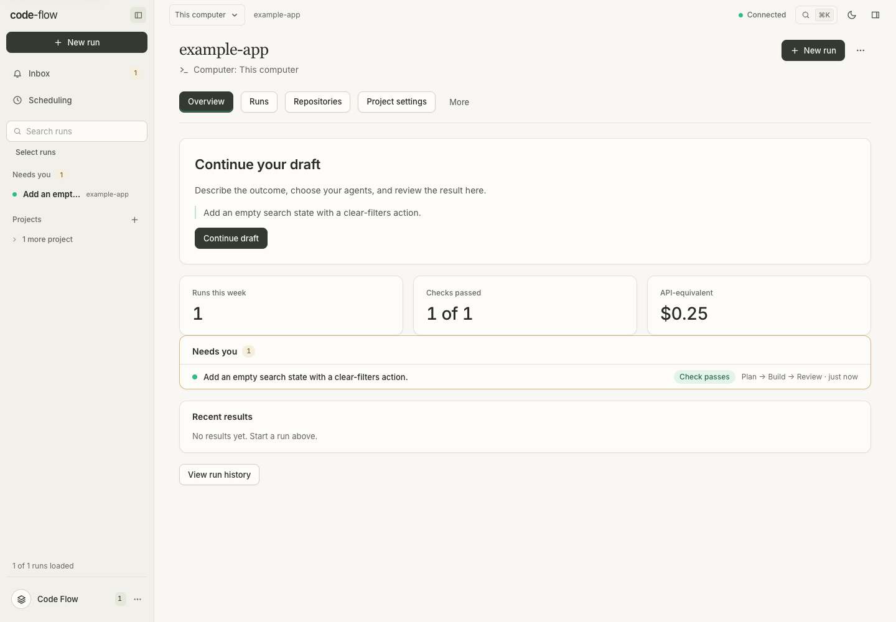

# Getting started

Take a small, well-defined task from your own repository to a reviewed result. This guide covers installation, your first run and the settings that influence what the agents receive.

## Requirements

- Node 22.13+ for npm or source installation. The macOS app includes Node.
- git 2.38 or newer: **Merge** relies on `git merge-tree --write-tree`, which 2.38 added. Check yours with `git --version`.
- At least one of `claude`, `codex` and `agy` installed and signed in. Run each CLI once interactively first. Open **Settings → Agents & models** to inspect provider health and model choices.

## Install and run

### Try the preview

On macOS, Linux or inside Windows **WSL2**, run:

```bash
npx --yes --package=https://github.com/midhunxavier/code-flow/releases/download/v0.1.0-preview.7/midhunxavier-code-flow-0.1.0-preview.7.tgz codeflow
```

The launcher starts Code Flow locally and opens your default browser with its sign-in link. Keep the terminal open while you work; press **Ctrl+C** to stop. If the browser does not open, copy the sign-in link printed in the terminal. Keep that link private.

On Windows, install Node, Git and your agent CLI inside WSL2, sign in there, and keep your repository in the Linux filesystem. Native PowerShell and Command Prompt execution are not supported in this preview.

For a desktop window on Windows, the source-built [WSL2 desktop preview](windows-desktop.md)
bundles Node.js and runs the backend in your Linux distribution, using its Git and agent CLI logins. Docker is not required.

For regular use, install the launcher globally, then start it with `codeflow`:

```bash
npm install -g @midhunxavier/code-flow@preview
codeflow
```

Run the same install command to update. Remove the launcher with `npm uninstall -g @midhunxavier/code-flow`.

### Download the macOS app

Choose **0.1.0-preview.7** for your Mac (**macOS 13+**):

- [Download Apple Silicon DMG (M1 or later)](https://github.com/midhunxavier/code-flow/releases/download/v0.1.0-preview.7/code-flow-0.1.0-preview.7-macos-arm64-unnotarized.dmg)
- [Download Intel DMG](https://github.com/midhunxavier/code-flow/releases/download/v0.1.0-preview.7/code-flow-0.1.0-preview.7-macos-x64-unnotarized.dmg)

Open the DMG, drag **Code Flow** to **Applications**, then open Code Flow. The Electron app opens its own desktop window. Closing or reloading that window keeps agents running. Click the Dock icon or **Code Flow → Show Code Flow** to return. Use **Code Flow → Quit** to stop the app; it asks before interrupting active agents. Node is bundled; install Git and sign in to a supported agent CLI before your first run. Install Chrome or Edge for the shared browser.

These are **unnotarized preview builds**. macOS may block them; use npm if blocked. Quit Code Flow before replacing it with a newer download. Run one launcher at a time. [Release notes and checksums](https://github.com/midhunxavier/code-flow/releases/tag/v0.1.0-preview.7).

The preview stores settings and history in `~/.codeflow`, outside the installation. Updating or removing the launcher preserves that folder.

### Install from source

```bash
git clone https://github.com/midhunxavier/code-flow.git
cd code-flow
npm ci
npm start            # http://localhost:4317
```

### Signing in

The first browser that opens code-flow is signed in automatically. That stays possible until a browser signs in (with or without the link) or code-flow first starts an agent, a check or an app. After that, other browsers need the link code-flow prints when it starts (`Open http://localhost:4317/?token=…`).

The session token exists only in the server's memory, so the agents code-flow runs can't use its API, even sandboxed ones with network access. A restart starts a new session. If the browser asks you to sign in, use the new owner link printed by that server.

## Development

For working on Code Flow itself, use either command after `npm ci`:

```bash
npm run dev       # deterministic demo agents; no real provider work
npm run dev:real  # installed real CLIs; sign in to each CLI first
```

Both modes use http://localhost:4318 and `.codeflow-dev` as their home directory, rebuild the UI and restart the server on source changes. For real-agent mode, install the CLIs you intend to use and run each interactively to sign in before starting. The normal `npm start` workflow above uses http://localhost:4317.

## Your first run


1. Choose **Open repository**, browse to a Git repository on the displayed computer, and choose **Open this repository**. Accept or change the suggested project name, then choose **Create project**. If the repository already belongs to projects, choose its destination. This opens the composer without starting an agent; no workspace or team setup is required.
2. Describe the task. Drag files from the **Files** panel, or from Finder, onto the task box to give the agents context. **Improve** (at the right of the task box) rewrites a rough task so agents can act on it: the same intent, with the goal first, the specifics, how to tell it's done, and any open questions. **Undo** puts your text back. Existing acceptance criteria are sent as separate context; the rewrite is told to preserve them without repeating or contradicting them.
   - It's one short turn by your configured agent (Auto by default), on your subscription, using its read-only permissions in a disposable private Git directory. Improve never resets your working checkout.
   - **Settings → Agents & models → Prompt improvement** configures Auto, Claude Code, Codex or Antigravity independently of the main task. Choose separate Quick and Repo models and supported reasoning effort for each provider, plus the default mode. Settings save in this browser for this computer. Auto preserves the Claude → Codex → Antigravity preference; a pinned agent reports availability, login or quota errors without switching agents. The Improve control shows the configured agent, and the completion note names the agent that performed the rewrite. Reset restores Haiku for Quick, Sonnet for Repo and low effort for Codex/Antigravity.
   - The arrow next to it picks a mode for the current composer without changing the saved default: **Quick rewrite** (the default) works from your text alone (by default, Claude's Haiku, or low effort for Codex and Antigravity). **Use the repository** reads a snapshot of the current committed version so the rewrite can name real files and commands; it takes longer. Uncommitted changes, untracked/ignored files and executable provider configuration are not copied.
   - **Stop** cancels. Editing the task or changing its repository, context, source or execution profile discards the old request; Undo applies only while the rewritten text is still current.
   - Improve supports the **local** execution profile. SSH and container selections disable it, and filesystem restrictions pause it. Other Code Flow mutations in that repository are refused until the turn and cleanup finish. Repository snapshots allow up to 5,000 regular files, 2 MiB per file and 128 MiB in total; unsupported symlinks, submodules and larger snapshots fail explicitly.
3. Open **Template library** and choose an optional intent starter: **Fix a bug**, **Build a feature**, **Review code**, or **Explore an idea**. Each selects an existing workflow and explains why. Existing task text is preserved; exploration disables the build/review roles for a design-only debate. You can still pick any workflow manually. Pick how the agents work together, and click an agent for each role. Under each role you can set that agent's model and effort for the role. The sentence under the team, such as *"Claude plans → Codex builds → Claude reviews"*, shows what will happen.
4. Review the **computer**, **project**, repository/branch, team, checks and execution limit in the compact summary. Pick the base branch with **Start from branch** above the task. Open **Run options** for the result branch name, rounds, limits, permissions and per-role model/effort. Provider defaults are in **Settings → Agents & models**. Set **Worktree setup command** (for example, `npm ci`) and the check command for this run. Agent conversations label it **Check command for merge validation** and do not run it automatically; ask the agent to test changes. AI-team and managed workflows use **Done when this passes** and run verification gates; save reusable commands in **Settings → Projects**. For local runs using a single check, **Repository readiness → Inspect readiness** checks the repository and installed providers. **Validate commands** executes setup and the check at the selected commit in a temporary worktree, with the time limit a run gives them (`limits.checkTimeoutMin`, ten minutes by default), so you can resolve setup failures before spending agent calls.
   Composer readiness checks the selected workflow and providers. Provider menus show sign-in and compatibility problems. Invalid custom model IDs remain editable after reload and block Start until corrected; failed model listings explain the error and retain custom-ID entry for supported CLI providers. Start errors are announced next to Send. Unused signed-out providers are skipped, while selected providers that are unavailable, incompatible or signed out block readiness. Auto still needs at least one usable eligible provider within its permitted pool.

5. Press **Start run** (⌘↵).
   - The run reads like a conversation: your task, then the agents' work as one list of steps (open any step to see its live transcript), then the result. A reply box stays at the bottom.
   - When the run finishes, each result is a branch such as `codeflow/<run>/build`, with buttons to review it, merge it, open a PR, or copy its diff command.
   - **Needs more work** records feedback for the current commit and opens its branch review. Add an overall or line comment, then **Send comments** to start a revision. Sending waits for the original writer to load unless you explicitly choose a recipient. A failed send retains your draft. Project-mission results use their mission's revision controls.
   - **More run actions → Edit & run again** restores the task, original base commit, provider/model choices, permissions, checks, limits and execution location into an editable draft. It creates fresh result branches and retains the original run's source restrictions. Reselecting the same repository retains the draft; editing CI-log options refreshes source context while keeping the pinned commit. Reattach any original attachments you still need. A restored custom verification profile is retained; choose a preset before saving it as a task template. When the project's draft holds unsent work, you are asked before it is replaced. The original base commit, permissions, checks and limits belong to that retry: once it starts, the next draft starts from the current branch with your usual defaults.

Review and merge results yourself if you prefer the command line:

```bash
git diff main...codeflow/<run>/build
git merge codeflow/<run>/build
```

## Return to a project

Open a project in the sidebar. **Overview** shows work needing attention, running work and recent results; **Runs** searches that project's history and can include archived runs. **Repositories** opens files, verification, context, history and services for a specific repository or run worktree. Existing Workspace bookmarks remain supported. **Project settings** keeps project editing, outcome metrics and recorded scenarios accessible. **More → Board** opens shared tasks on this project’s owning computer; **More → People** shows members, repository keys and authorized access controls. **More → Automation** contains Run once later, Repeat, Process a backlog and Pursue a mission. Board and Automation become visible tabs when configured, even when the optional Board shortcut is off. Command search finds every destination.



**New run** opens the project's saved draft. Text, attachments, selected files, workflow and run options are saved separately for each project on each computer. Browsing another project's page or filtering Inbox does not change the draft's destination. The composer shows one repository directly or a selector for multiple repositories. **Open another repository** asks you to choose or explicitly extend a project before launching.

Existing browser drafts migrate once. Ambiguous drafts remain **Unassigned draft** in the composer project picker until you choose a destination. A removed project or repository blocks launching into it; the draft remains available. If draft storage fails, keep the tab open and use **Retry saving**.

## Find help in the app

Open **Application menu → Help & documentation** for the searchable local guides. **Ask code-flow** answers questions from these guides using an installed CLI. See [the help guide](help.md) for supported providers, privacy and limits.

## Giving agents context

The **Files** tab of the [side panel](runs.md#the-side-panel) (the **Files** button under the task, or <kbd>\</kbd>) shows the selected repo: ignored files are hidden, files with uncommitted changes are marked **M**, and untracked files **U**. To add something to the task's context, drag it onto the task box, click **+**, or double-click it; clicking a file opens it to read. Once added, **−** removes it. Folder listings with more than 1,000 entries say they are limited; use file search to reach omitted entries. You can also add files from your computer, such as specs, screenshots or logs (up to 10 MB each, 25 MB in total). Drop them from Finder, or use **Attach**.

Every agent's first prompt gets a *Context from the user* section listing these items. Nothing is pasted into the prompt:

- Repo files and folders that are identical in the base branch are referenced by path; every worktree already has them.
- Your **working-copy** version of a file is copied into `.codeflow-context/repo/<path>` in each worktree when the file is uncommitted or differs from the base branch. The agent sees exactly what you see.
- Dropped files are copied into `.codeflow-context/attachments/`.
- `.codeflow-context/` is listed in `.git/info/exclude`, so it never ends up in an agent's commit.
- Folders that aren't in the base branch are rejected. Commit them, or drop the individual files.

## Models and effort

**Settings → Agents & models** sets a model and a reasoning effort per provider. Every role that uses that provider runs with them. Leave either on *Default* to use the CLI's own configuration.

After signing in, signing out or changing an installed CLI, use **Refresh providers**, or **Health & usage → Check again**, to discover models and account status again immediately. Background listings can be cached for ten minutes. Health shows a reported usage limit and reset even when the CLI does not report a percentage. A model catalog that has never been discovered stays **unknown**; **stale** means it has older discovery evidence.

| Provider | Model list | Flags passed |
|---|---|---|
| Claude Code | aliases `fable`, `opus`, `sonnet`, `haiku`, or any full model name via *Other…* | `--model`, `--effort` (low … max) |
| Codex | `codex debug models`, with each model's supported efforts; the default comes from `~/.codex/config.toml` | `-m`, `-c model_reasoning_effort=…` |
| Antigravity | `agy models` | `--model`, `--effort` (low … max) |

**Per role:** under each role in the team, every agent you picked has a model picker and an effort picker. They override the provider's setting for that role only, for example Opus to plan and Sonnet to review. Left on *Default · …*, they show what the agent will use.

Model lists are cached for 10 minutes. Your choices are remembered in the browser.

## Worktrees and branches

Every worktree a pattern needs (`build`, `candidate-a`, `integration`, …) is created with:

```bash
git worktree add -b <prefix>/<name> <repo>/.worktrees/<run-id>/<name> <base>
```

- **Base branch:** the starting point for every worktree in the run. By default this is the repo's current `HEAD`. The dropdown also lists local branches, remote branches, and the result branches of earlier runs, so you can build on a previous result. Uncommitted changes in your checkout aren't included. A chosen branch's committed `.codeflow/config.json` supplies the run's defaults ([Configuration](configuration.md#per-repo-config)). If a draft's branch has since been deleted, the draft starts from the current branch and says so.
- **Result branch prefix:** defaults to `codeflow/<run-id>`. If you set it to, say, `feat/rate-limit`, results land on `feat/rate-limit/build`. A prefix can only be used once, because git can't have both a `feat/rate-limit` branch and `feat/rate-limit/…` branches. It's taken as the run starts, before its branches exist, so of two runs started at once with the same prefix only the first gets it, and it stays the run's while the run is in your history.
- **Submodules:** a worktree of a repo with a `.gitmodules` gets its submodules checked out (`git submodule init`, then `git submodule update --init --recursive`, for up to 10 minutes). `init` registers them in the repo's `.git/config`, as it would in your checkout. If cloning one fails (say a private submodule git would have to prompt for), the worktree is still created, without it.
- **Location:** worktrees go in `<repo>/.worktrees/`. code-flow adds `/.worktrees/` to `.git/info/exclude`, which keeps them out of `git status` without editing your `.gitignore`. Tools that don't read git's ignore files (some test runners, linters, `tsc` globs) may still scan `.worktrees/`. Exclude it in their config, or set `CODEFLOW_WORKTREE_DIR` to an absolute path to keep worktrees outside the repo.
- **Cleanup:** remove a run's worktrees with `git worktree remove .worktrees/<run-id>/<name>`, or delete the folder and run `git worktree prune`. The branches stay until you delete them. **Archive…** on a run (**Archive and clean up…** in an Agent conversation's sidebar menu), and **Clean up** in [Insights](runs.md#insights-comparisons-and-finding-runs), do this for you. code-flow only ever removes git's record of its own worktrees: it never runs `git worktree prune`, which would also forget your own worktrees whose folder is missing just now (a drive that isn't mounted).

Next: [Team patterns](patterns.md) · [Talking to a run](runs.md)
