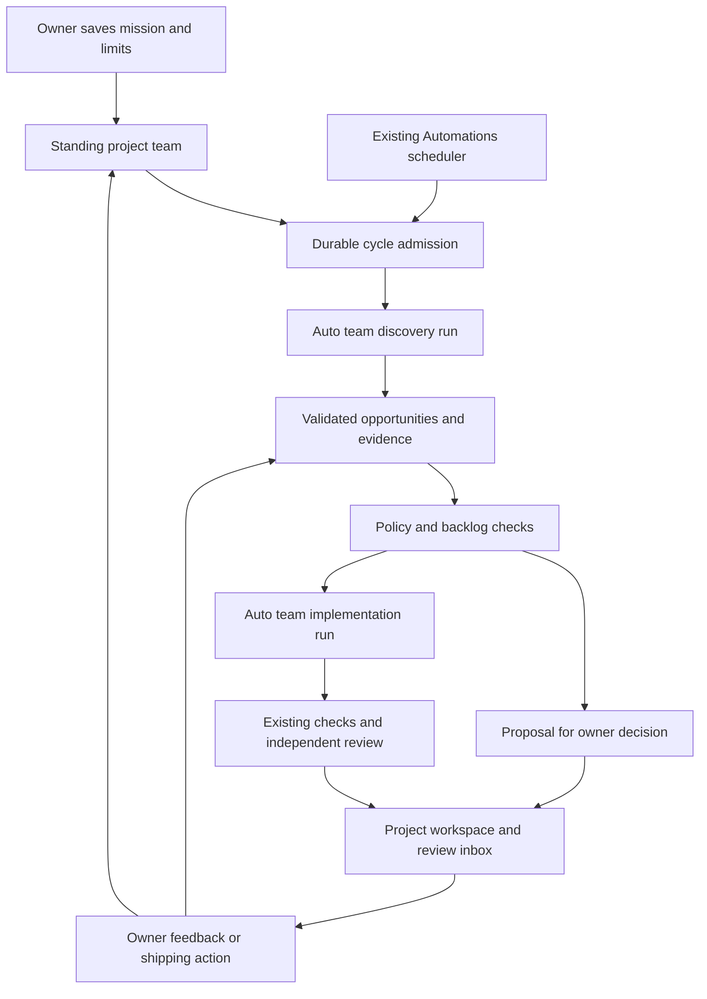

# Standing project teams implementation plan

Status: implemented as an opt-in preview on 19 October 2026, synchronized with `origin/main` at `7933ecf` before PR review. The requirements below retain the design context. The implementation record here and [the operating guide](project-teams.md) describe the implemented interfaces and deliberate initial boundaries. Real-provider usefulness remains an unmeasured rollout gate.

## Implementation record

| Phase | Implemented result |
|---|---|
| P0 | Strict mission/report/aggregate contracts, provider eligibility, immutable mission history, private atomic store, operation IDs, repository uniqueness and rolling reservations |
| P1 | Managed Automations targets, stable scheduled occurrence IDs, shared timer, engine dispatch barrier, durable launch receipt, exact reconciliation and fail-closed unknown launches |
| P2 | Existing Auto team investigation workers, coordinator report synthesis, independent report review, typed discovery receipts and no-diff preservation |
| P3 | Deterministic ranking, verified source quotes, deduplication, one implementation child, enforced scope/size/call limits, final-commit checks/review and approval-bound publishing |
| P4 | Project setup, provider/model choices, existing schedule editor, opportunity actions, run evidence links, inbox summaries, managed automation links and scoped shared stream |
| P5 | Owner feedback and defer expiry, bounded recent local activity/commit context, unchanged-input detection, notification reuse/deduplication and conservative restore handling |
| P6 | Fault/restart/scope/budget/privacy/compatibility tests, browser workflow and connection checks, bounded fake/real evaluation runner, documentation and an opt-in release flag |

Implementation choices relative to the proposed design:

- `Trigger.target` identifies the managed team while `Trigger.run` retains a minimal display/routing projection for compatibility with existing automation screens. It contains no duplicated execution configuration. Trigger IDs are deterministic from team IDs.
- The aggregate service is in `src/project-teams.ts`, scope guards in `src/project-team-policy.ts`, and the UI in `ui/project-teams.tsx`; separate context/discovery/state modules were unnecessary for the current bounded workflow.
- Report synthesis is an explicit coordinator read turn followed by the existing independent reviewer. Discovery therefore requires at least eight allocated calls under Auto team's coordinator allowance. Report defects stop the cycle; an owner can start another bounded discovery rather than silently repair it.
- Pausing between stages finishes discovery as proposals. After activation the owner can build a proposal explicitly. A changed base/configuration requires rediscovery; the initial preview does not attempt an automatic rebase or extra revalidation allocation.
- Owner revision launches a new whole team from the pinned base, with previous-result references and feedback. It preserves scope and independent verification without relying on the generic single-writer follow-up route.
- Initial evidence is local Git source/history, bounded owner-origin local run summaries, accepted memory through existing Auto team retrieval, and durable owner decisions. External issue/feedback ingestion and product analytics are not enabled sources in this preview.
- Mission model choices reuse the existing model controls. Setup uses existing Safe/Standard/Trusted host execution; remote worker, agent-container, ACP and extension execution are excluded from managed cycles. Owner-chosen setup/check commands use the current host execution boundary.
- APIs use `POST /:id` for pause/activate/edit, `GET /:id/preview`, and `POST /:id/opportunities/:opportunityId` for decisions; see the operating guide for the complete actual table.
- Core tests and synthetic fixtures establish mechanics. The ten-cycle synthetic pilot across two fixtures produced two verified drafts and eight unchanged-input no-ops. It is not the proposed real-provider/owner-quality pilot below. The feature stays opt-in until that evidence is available.

Code Flow will let an owner attach a standing agent team to a repository, give it a product mission, and choose a schedule. The team will discover opportunities, select worthwhile work, build bounded improvements, and bring concrete results back for review. The owner decides what becomes part of the product.

Build this as a project service above the existing Automations and Auto team systems. Automations owns the schedule. Auto team owns agent execution, worktrees, messaging, checks, and independent review. The new service owns the mission, opportunity backlog, cycle state, admission decisions, and feedback across runs.

## 1 Product behavior

The owner opens a project and selects **Set up project team**. Setup captures the repository and target branch, intended users, product mission, current priorities, excluded work, agent preferences, schedule, and budget. Code Flow may draft a product description from repository evidence, but that description becomes direction only when the owner saves it.

For example:

> Improve the first experience for developers using this product. Investigate confusing setup, broken flows, and small usability improvements. Work weekly. Build one small improvement that I can try, and explain why you chose it.

A cycle produces up to three useful opportunities and, when permitted, one draft implementation. An opportunity contains the problem, affected users, supporting evidence, expected benefit, proposed solution, effort estimate, acceptance criteria, and uncertainties. An implementation adds a branch, verification evidence, and a way to inspect or try the result.

The project page shows **Opportunities**, **In progress**, **Ready for review**, and **History**. The existing run view remains the place to inspect individual agents, messages, tasks, checks, and changes. The existing review inbox receives actionable results and blockers.

The team remembers owner feedback. “Not relevant to our users” influences future selection; “later” defers an opportunity; “do not suggest this again” suppresses it. Feedback does not silently change the team's execution authority.

### Initial defaults

These are proposed defaults to validate in a pilot, not measured optimal settings.

| Setting | Initial value |
|---|---|
| Scope | One repository and one explicitly selected base branch per standing team |
| Team count | One active standing team per canonical repository, including across projects |
| Cadence | Weekly at a user-selected local time, with an explicit IANA timezone |
| Other schedules | Daily, selected weekdays, or an interval using the existing schedule editor |
| Autonomy | Discover and build small improvements within saved scope; proposals only is also available |
| Visible output | At most three new opportunities and one new implementation per cycle |
| Active work | One active cycle per team; no overlapping standing-team builds for its repository |
| Review backlog | At most two unresolved implementations, including approved but unshipped work |
| Opportunity backlog | At most twelve open opportunities; defer discovery when the backlog needs triage |
| Cycle budget | At most 24 CLI invocations and 60 active run minutes |
| Allocation | Discovery: 8 invocations and 15 minutes; implementation: 16 invocations and 45 minutes |
| Rolling budget | At most 48 invocations and 120 active run minutes over seven days |
| Shipping | Owner action through existing PR or merge flows |

Changing cadence does not expand the rolling budget. Setup previews the next runs and explains when a chosen daily schedule can exhaust its allowance. The app must be running and its execution machine available, as with current automations.

### First release boundary

Deliver persistent project responsibility, scheduled discovery, bounded automatic implementation, reviewed results, and feedback in the first release. Use local repositories and the installed providers eligible for unattended Auto team runs. Start with the validated built-in CLI adapters; a provider being connected or available for an interactive run does not make it eligible for a standing team. A minimal team is sufficient; additional specialists are created only when useful within the allocation.

Keep cross-repository initiatives, remote-worker execution, multiple standing teams on one repository, automatic shipping, autonomous external posting, analytics integrations, and an always-running agent process for later releases. A project containing several repositories can initially select one repository for its standing team.

ACP/OpenCode connections remain available through the existing interactive experience. Their current adapter requires Full access and rejects automated triggers, so the first standing-team release cannot use them for discovery, implementation, or **Run now**. Adding unattended ACP support is a separate adapter capability milestone; this feature must not bypass that restriction.

The team identity persists as mission, preferences, decisions, and knowledge. Provider sessions and private worker conversations remain scoped to individual runs. Persistent responsibility does not require a permanently running CLI process.

## 2 Existing foundations and required extensions

| Existing component | Current behavior | Planned use or change |
|---|---|---|
| [Projects](../src/projects.ts) | Groups repository paths and remembers composer/team defaults | Link a standing team to explicit project membership; keep its mission separate from last-used composer defaults |
| [Automations](../src/automation.ts) | Schedules, timezone handling, missed-run rules, manual runs, webhook history, per-trigger busy checks | Add a managed project-team target and cycle receipts; retain the existing clock and schedule computation |
| [Auto team](../src/patterns/auto-team.ts) | Plans work, schedules dependencies, routes questions, integrates changes, checks and independently reviews them | Run discovery and implementation as separate Auto team runs with server-owned contracts |
| [Auto team model](../src/patterns/auto-team-model.ts) | Validates plans, revisions, ownership and outcomes | Validate discovery-only plans, typed opportunity output, and implementation scope on initial plans and revisions |
| [Provider registry](../src/adapters/index.ts), [routing](../src/routing.ts) and [team capabilities](../src/adapters/team-tools.ts) | Registers built-in, extension and ACP provider IDs; resolves automatic choices and reports capabilities | Derive a restricted unattended inventory before resolving any team role; preserve dynamic provider IDs and validate them against that inventory |
| [ACP connections](../src/acp-connections.ts) and [shared ACP adapter](../src/adapters/acp.ts) | Settings-managed connections, discovered models, invocation fingerprints and local Full-access execution | Reuse connection discovery/display; show why ACP is currently ineligible for standing teams without changing its execution policy |
| [Engine](../src/engine.ts) | Runs providers, limits invocations, manages worktrees, approvals, follow-ups and result triage | Add standing-team provenance, durable admission hooks, and guarded continuation/result handling |
| [Team memory](../src/team-memory.ts) and [memory store](../src/memory.ts) | Attributed private, team and project memory with revision and applicability checks | Supply accepted knowledge to later cycles; keep candidate ideas and product decisions in their own records |
| [Deferred runs](../src/deferred-runs.ts) and [repository coordination](../src/repo-coordination.ts) | Durable claims, bounded execution, explicit unknown states and recovery | Reuse their storage and launch-receipt patterns without adding a competing agent queue |
| [Coordination API](../src/coordinated-api.ts) | Validates exact owned run identity, pinned verification and shipping evidence | Extract narrow receipt/result-validation helpers where genuinely shared |
| [Review inbox](../src/review-inbox.ts) | Prioritizes questions, blocked work, failures and pending run results | Add opportunity decisions and group child-run attention under a project-team cycle |
| [Notifications](../src/notifications.ts) | Configured deliveries with deduplication and retries | Reuse delivery handling for meaningful cycle changes and avoid duplicate child-run notifications |
| [Verification](../src/verification.ts) | Required gates, criterion mappings, pinned reports and merge-result checks | Require real evidence for implementation readiness and revalidate moving results |
| [Project UI](../ui/project.tsx) and [automation UI](../ui/automations.tsx) | Project overview, schedules, review results and run navigation | Add the team workspace and expose its schedule as a managed automation |
| [Shared browser stream](../ui/stream.ts) and [stream server](../src/stream.ts) | Multiplexes run, Team inbox and terminal subscriptions across owner tabs | Carry project-team updates through the existing broker and preserve its connection and identity boundaries |

### Behaviors that cannot be reused unchanged

1. `RunManager.startResolved()` clears plan approvals for triggered runs. A saved team policy must authorize autonomous work before launch; “this is scheduled” is insufficient authority to implement any idea the model invents.
2. `Automations.busy()` checks the most recent run for a trigger. A cycle can contain discovery and implementation, so durable cycle state must remain authoritative between those runs.
3. `Automations.save()` currently logs persistence errors without rejecting the operation. Team activation and launch admission cannot depend on a successful-looking save that failed. Add a strict committed-write path and use it for managed triggers.
4. `toInbox()` can archive unchanged automation results and remove their worktrees. Discovery findings must be durably imported before normal cleanup, and evidence-only results must not disappear because their Git diff is empty.
5. `triage({decision: "revise"})` currently routes a revision to a writer follow-up. Project-team revisions must preserve or renew whole-team verification before becoming ready again.
6. `Projects.place()` supports lenient placement for triggered runs. Standing-team children must use `requireProjectRepo` and explicit membership checks, with no fallback into another project after deletion or removal.
7. Current notification payloads and review grouping are run-oriented. A cycle with two child runs should present one coherent result while preserving direct access to child failures and questions.
8. `validateRoles()` uses requested/repository trust when resolving providers, while `startResolved()` applies the unattended Full-to-Trusted cap later. Managed requests must calculate effective execution eligibility before role selection and validate explicit choices too; otherwise an ACP selection can pass preparation and fail only at engine launch.

### Provider eligibility on the current baseline

The updated Auto team schema accepts an exact provider ID from the eligible inventory instead of a fixed three-provider enum. Preserve that schema behavior in the new discovery contract. Validate IDs through the registry and host policy; do not restore a hard-coded schema enum or accept arbitrary strings merely because they match an `acp:` or `plugin:` prefix.

| Provider class | Initial standing-team treatment |
|---|---|
| Built-in Claude, Codex and Antigravity CLI adapters | Eligible when installed, selected by the owner, compatible with the effective execution profile and within observed capacity; retain current adapter-specific limits |
| ACP/OpenCode connections | Ineligible for all managed phases because the current engine rejects automated triggers and requires Full access |
| Owner-installed provider extensions | Keep out of the initial standing-team pool until their unattended execution and structured-outcome behavior have explicit compatibility evidence; ordinary extension runs retain their existing behavior |

Add a small shared eligibility helper, proposed as `src/provider-eligibility.ts`, to compute provider IDs and rejection reasons from the execution context. Reuse current registry, availability and adapter restrictions. Keep the standing-team compatibility allowlist as an additional policy input, so factoring the helper does not change existing interactive or ordinary-automation behavior.

Resolve the effective unattended trust profile before invoking `resolveAuto()`. Apply the helper to coordinator selection, worker/reviewer pools, explicit IDs, omitted/default pools, inherited project presets, planning inventory, coordinator revisions and every later dispatch. Filter defaults with a visible explanation; reject an explicitly saved ineligible selection before activation. Recheck after Settings changes. A missing or changed selected provider blocks work or uses only an already-authorized eligible fallback; it cannot silently expand the pool or enable Full access.

Provider display names and model catalogs come from the existing registry/Settings flow. Preserve opaque model IDs and use the current provider-specific settings validators. A successful ACP connection probe establishes protocol/session/catalog observations, not available inference quota, sandboxing or unattended compatibility. Scoped live tools and constrained JSON are separate capabilities: structured outcomes can use prompt-and-validation fallback where supported, while an unavailable tool bridge stays unavailable.

A future ACP compatibility milestone must establish an accepted unattended execution/isolation policy, report validation and retries, cancellation/recovery and accurate usage accounting. Preserve `Run.acpConnections` fingerprints and `assertAcpBindings()` if that milestone is later delivered; fingerprints pin command/arguments, not executable bytes or external CLI configuration. Two connection IDs are not evidence of independent model vendors. Until that work is complete, no managed request may omit its trigger metadata to evade the engine's ACP restriction.

## 3 Architecture and execution ownership

Add a `ProjectTeams` service. It performs deterministic state transitions, accepts validated model output, and prepares normal run requests. It does not invoke provider CLIs directly or implement a second task scheduler.

Use one managed automation for each team. A cycle contains a discovery child and zero or one implementation child. Completion events advance the cycle; periodic reconciliation through the existing automation tick recovers missed events. The cycle service subscribes to `RunManager.subscribeAll()` and treats events as wakeups, not as the authoritative record of completion.

Before advancing a child, reload its settled state and validate identity, evidence, and persistence. The run's `endedAt` and final bookkeeping must be present; an intermediate `status: done` event alone is insufficient.

The existing Auto team task scheduler remains responsible for members and task dependencies within each child. Existing global agent slots continue to govern capacity across manual and scheduled work.

Register the service with `startPolicyBackground()`, `pausePolicyBackground()` and shutdown in `src/server.ts`. Stop and drain in-flight preparation/launch work before filesystem-policy changes, as existing background services do. Reconciliation can use the existing tick and subscriptions; it needs no additional scheduling clock.

## 4 Data model and persistence

Add versioned types in `src/project-team-model.ts`. Keep the following objects distinct so that product feedback cannot accidentally become execution permission or a verified technical fact.

| Record | Required information |
|---|---|
| `ProjectTeam` | ID, revision, project ID, canonical repository identity/path, name, status, managed trigger ID, current mission revision, creation/update times |
| `ProjectTeamMission` | Immutable revision, intended users, mission, priorities, exclusions, base branch, enabled evidence sources, provider/model preferences, autonomy mode, execution policy and budget settings |
| `ProjectTeamCycle` | ID, team ID, immutable mission snapshot/hash, trigger occurrence or manual operation ID, pinned base SHA, source manifest, eligible-provider snapshot with reasons and effective trust, child claims/runs, state, selection receipt, usage reservations and timestamps |
| `ProjectOpportunity` | ID/revision, team/repository identity, stable problem key, category, problem, affected workflow, evidence refs, hypothesis/observation distinction, proposal, benefit, effort/risk estimates, acceptance criteria, rank explanation, status and source cycle |
| `ProjectTeamDecision` | ID, opportunity and exact revision, authenticated actor, decision, optional reason, result commit/report hash where applicable, timestamp and operation ID |
| `ProjectTeamLaunch` | Cycle/stage/attempt, claim ID, input hash, reserved allowance, run ID if known, receipt state and reconciliation data |
| `ProjectTeamResult` | Opportunity revision, child run ID, owned result branch and SHA, verification/report references, independent-review identity, preview references, readiness and shipping receipts |

`ProjectTeamMission` includes two autonomy modes: `propose` and `build-within-scope`. Store explicit allowed work categories, included/excluded relative paths, maximum change size, pinned verification profile, and the owner's chosen existing execution/isolation settings. Semantic judgments such as “small UX improvement” need an explanation and conservative escalation; they are not completely enforceable through a file count.

Add optional `Run.projectTeam` metadata containing `teamId`, `cycleId`, `missionRevision`, `phase`, `claimId`, `attempt`, and, for implementation, `opportunityId` and `opportunityRevision`. Preserve it in run snapshots, replay, exports, and UI types. The server constructs this metadata. Generic run-creation bodies, webhook payloads, agent messages, and collaboration tools cannot supply or alter it.

### Store design

Use `CODEFLOW_HOME/project-teams/<team-id>.json` as one versioned aggregate per team for configuration revisions, opportunities, cycles, decisions and launch claims. Follow the strict atomic write pattern already used by deferred/coordinated services: serialize mutations, validate bounded input, write a private temporary file, sync it, rename it, and sync the directory where supported. Publish in-memory state only after the write succeeds. Use optimistic revisions and operation IDs for HTTP mutations.

A single team aggregate makes opportunity selection, budget reservation and stage claiming one atomic mutation. Use the existing single-server ownership model plus an in-process canonical-repository guard for the initial one-active-team constraint. Validate all teams at startup; duplicate active ownership is an explicit configuration blocker.

Bound the aggregate, history and payload sizes. Start with a 16 MiB file ceiling, 100 retained cycle summaries and 200 full opportunity records. Store large evidence in existing run artifacts or bounded evidence files with immutable digests, not in the aggregate. Preserve compact rejection/deduplication records separately within a fixed cap; reaching retention limits must not silently forget “do not suggest again.” Archive or request cleanup before that cap is exceeded.

Include the new aggregates and retained evidence in the existing backup/export and maintenance inventory. Evidence cleanup follows live references from opportunities and decisions, so archiving a discovery child cannot break a pending review card. Redaction and deletion must cover copied evidence as well as run links.

Persist provider references and execution-binding metadata, not copied ACP executable configuration or credentials. Keep `acp-connections.json` excluded from portable backups under the current maintenance policy. Restoring a team on another host leaves it paused until project paths, providers, referenced connections and execution settings are explicitly reconciled; portable mission data cannot authorize a new host invocation.

Do not automatically delete pending results, active claims, or owner decisions to meet a size limit. Keep all claims needed to account for unresolved work. A corrupt/unsupported aggregate blocks that team's launches while leaving ordinary runs and other teams usable.

## 5 Scheduling and launch recovery

### Managed trigger contract

Extend the trigger model into an explicit union. Existing records without a discriminator remain saved-run triggers; existing sweeps retain their behavior. A new `kind: "project-team"` target stores `teamId`, `projectId`, name, enabled state and schedule, without a duplicated saved run configuration. Its execution configuration comes from the current saved mission.

Managed triggers initially reject webhooks. Schedule and **Run now** both call the same `ProjectTeams.requestCycle()` admission path. Add a managed-target callback to `Automations`; keep provider launching in `RunManager`. Update `FireResult`, event history and preview responses to include `cycleId`, child run IDs when available, and meaningful dispositions such as `accepted`, `skipped`, or `blocked`.

Use the existing `Schedule`, `validateSchedule()`, `previewSchedule()`, `nextFire()` and missed-run behavior. Supply a stable occurrence key from the trigger ID and the scheduled UTC `nextAt` captured before advancement. Manual requests use a client operation ID; retries reuse it. Repeated ticks, duplicate HTTP delivery or restart recovery return the same cycle for that key.

Creation spans two existing stores. Use a recoverable activation sequence: create a draft team, create a disabled managed trigger idempotently, save the linkage, then activate the linked pair. On restart, incomplete setup remains disabled until reconciliation verifies both records. A trigger with no valid team or a team with a missing trigger cannot launch. Managed-trigger enable, schedule changes and deletion route through the team service so Settings cannot bypass team state.

Update all trigger readers, previews, project filters, serializers and UI types that currently assume `trigger.run` exists. Preserve old saved-run/sweep payloads and their tests. Unknown target kinds remain disabled and diagnosable; they must never be interpreted as ordinary saved prompts. The managed-trigger persistence path commits or fails explicitly without overwriting the last committed state or poisoning subsequent writes.

### Admission and advancement

At cycle admission, check active status, exact project membership, canonical repository, configured branch, effective unattended provider eligibility/readiness, filesystem policy, remaining budget and backlog capacity. Pin the base commit, configuration and allowed provider choices. Never use whichever branch happens to be checked out later. Do not implicitly pull, rebase, or fetch; show the observed ref and last known freshness. Optional remote refresh belongs in a later explicit source setting.

Recheck these conditions before each child launch and continuation. A later restrictive policy change or repository removal blocks further work even though a historical mission snapshot exists. An expanded mission requires a new cycle or explicit revised request; it cannot enlarge an already-admitted allocation.

| Failure point | Required behavior |
|---|---|
| Before a durable launch claim | No run starts; a later tick can retry admission |
| Claim saved, no dispatch attempted | Retry only when the service can prove dispatch never began |
| Dispatch started, receipt missing | Mark `unknown`; inspect exact owned run identities and retain reservations |
| One matching persisted child found | Attach the child idempotently and continue observing it |
| No conclusive match or multiple matches | Block automatic replay; expose recovery with the available evidence |
| Child finished before cycle state was updated | Import its validated result once, using run ID, report hash and input revision |
| State write fails | Stop dependent dispatch and expose a storage blocker |

Extract a narrowly scoped receipt helper from the existing coordination/deferred patterns. Add an internal admission barrier for managed child starts so the initial run identity and claim binding are synced before any CLI execution begins. Do not acknowledge an admitted launch based solely on best-effort event logging. Prove this ordering with an instrumented fake CLI.

This supports idempotent control transitions, not a promise of exactly-once external side effects. A process can act immediately before a crash. Preserve unknown states and existing execution-isolation limits.

### Lifecycle rules

Cycle states are `requested`, `discovering`, `selecting`, `building`, and terminal `completed`, `no-op`, `skipped`, `blocked`, `failed`, `cancelled`, or `unknown`. A cycle completes when its results are durably published; an opportunity can remain awaiting human review after the active-cycle lock is released.

Pause prevents new child starts and new cycles; running children can finish and publish their result. **Stop current work** also invokes existing cancellation and retains partial work. **Resume** rechecks policy and capacity. Automatic restart never grants a fresh budget to a blocked or interrupted child. An explicit resume is a new bounded allocation with cumulative usage visible.

A paused cycle waiting between stages keeps its last stage and a durable wait reason; it neither holds a provider slot nor silently becomes a new cycle. **Run now** requires an active team. Repeated failures with the same unresolved cause block further automatic attempts until the relevant configuration/input changes or the owner explicitly retries; a new scheduled date alone does not authorize repeating a failed build.

Project deletion or repository removal blocks pending dispatch and cancels active owned children through existing cancellation. Retain history and branches for inspection. Archiving a team disables its trigger without treating its unmerged results as shipped or silently deleting them.

## 6 Discovery and opportunity selection

### Evidence collection

Build a bounded source manifest from the selected repository, recent changes since the previous cycle, existing run findings, open opportunity/decision records, accepted project memory, and explicitly enabled issue/PR integrations already available in Code Flow. Also include known manual work so a team can avoid proposing work already underway.

Record source IDs, revisions, timestamps, branch/commit applicability, content digests, and omissions caused by limits or unavailable connections. Resolve evidence references in the host; the model cannot assert that an invented issue, path or test result is verified. External text retains its provenance and current untrusted-source treatment through summaries and candidate reports.

Repository access is sufficient for technical findings. Product feature ideas without user evidence are labeled hypotheses. Live app exploration is optional and uses an owner-configured launch profile and existing browser capability where available. Do not claim a workflow was exercised when the team only inspected source.

Skip expensive discovery when the input fingerprint is unchanged: base commit, mission revision, enabled source revisions, decisions and relevant memory revisions. Add a configurable full rescan interval, initially four weeks, so unchanged code can still receive a fresh review. A skipped or empty cycle is a successful outcome and creates no artificial improvement quota.

### Auto team discovery contract

Add a server-owned discovery contract to Auto team rather than registering a new agent runtime. It must:

- Permit only `investigation` tasks in both the initial plan and every coordinator revision.
- Designate one reporting task whose dependencies include all required investigations.
- Use a discovery-specific plan/outcome schema with a versioned `project-opportunities/v1` report. Keep ordinary and legacy Auto team schemas compatible.
- Preserve the current dynamic provider-ID schema and validate every initial or revised member against the recorded unattended inventory. Do not assume a provider supplies native constrained JSON, live steering or scoped team tools.
- Bound candidate count, text lengths, source references and acceptance criteria; publish at most three new visible opportunities per cycle.
- Collect the report from structured output and journal it. Never parse proposals from the final Markdown summary or scrape private memory.
- Include the exact report and digest in independent review context; publish only the report revision that was reviewed.
- Allow an empty report with an evidence-based reason.

The reporter can be a worker or the coordinator when the allocation permits. Initial planning and coordinator synthesis both count against Auto team's existing coordination limit. Reserve the independent review turn before admitting optional investigation tasks. With the default eight discovery invocations, the coordinator ceiling remains two.

Persist a discovery review receipt binding the report digest, source manifest, run ID, reviewer step and acceptance verdict. The cycle imports exactly that report revision. A candidate is not approved simply because the same Git HEAD passed an unrelated review.

Discovery has no implementation repair turn. If review finds a report defect, bounded repairs remain read-only and may revise the report; the generic Auto team repair path must not introduce a write turn. Existing read-mode snapshot/restore, filesystem policy and adapter isolation still apply. Runtime-created worktrees and persisted report artifacts are allowed; source changes are not discovery output.

### Deduplication and ranking

First compare against active opportunities, rejected/deferred decisions, existing issues/PRs and recent manual runs. Use source keys plus normalized problem identity, affected paths/symbols and acceptance criteria. A repository commit changing must not by itself turn an old idea into a new one. Model similarity suggestions can assist grouping, but the host preserves distinct IDs and decision history.

For each eligible candidate, record mission alignment, expected impact, evidence confidence, estimated effort and risk with short explanations. Use a deterministic, versioned ranking policy over those estimates, with stable tie-breaking; do not present scores as measured user benefit. Preserve the selection receipt, including why other candidates were deferred.

Automatic implementation requires all of the following:

- `build-within-scope` is enabled in the saved mission.
- The problem and proposed work fit the allowed categories and paths.
- Evidence is sufficient for the proposed action and has current applicability.
- No active or suppressed matching work exists.
- Acceptance criteria are testable with a configured verification profile.
- The change fits budget, review capacity and size limits.
- No unresolved product decision or excluded-risk change is needed.

Otherwise keep the idea as a proposal with the reason it needs owner input. Initial exclusions should cover broad rewrites, schema migrations, authentication/permission changes and billing changes unless the owner explicitly authorizes the particular work. New feature experiments may be built when explicitly included in the mission, but their claimed benefit remains a hypothesis until evaluated.

## 7 Implementation and review

Convert the selected opportunity revision into a normal `auto-team` request containing the problem, evidence references, intended outcome, acceptance criteria, allowed paths, exclusions and pinned verification profile. Attach the immutable mission/cycle provenance through the server. Agent-generated report text is contextual evidence, not a new owner instruction.

Use fresh implementation worktrees from the selected base. If the target branch moved after discovery, mark applicability stale and use a bounded read-only revalidation before implementation; that turn consumes the same cycle budget. If the candidate or base must materially change, record a new candidate revision and selection receipt. Do not silently build an obsolete proposal or carry unused approval across a changed scope.

Apply saved scope constraints to initial planning, coordinator revisions, every write/integration/repair path, and the final diff. The Auto team validator must reject ownership outside allowed paths or tasks outside the approved goal. After write turns, inspect actual changed files, including untracked files and rename destinations. Excluded paths, changed verification commands, excessive changes or unresolved scope deviations stop automatic integration/readiness and produce an explicit result to inspect.

Enforce managed ownership at the engine boundary as well as in the new API. Resume, follow-up, revise-goal, whole-team continuation and selective-rerun actions on a managed run must obtain a fresh valid allocation from the team service, preserve lineage, and recheck pause/membership/scope. Generic run endpoints cannot bypass these checks. For an in-place resume, bind the new allocation in the existing run journal; keep the original launch identity intact. Linked new runs receive their own launch claim and receipt.

These are execution and result gates layered on existing sandbox policies; path checks do not create an OS security boundary. Agents do not gain wider shell/network privileges merely because they belong to a standing team. Check/setup isolation and agent isolation remain separate existing settings and are pinned for each allocation.

### Readiness conditions

A result becomes **Ready for review** only when the implementation exists, required acceptance evidence is present, configured required checks pass, independent review approves the same final commit, and existing fail-to-pass proof succeeds when enabled. Validate branch ownership and current HEAD against the exact recorded evidence, as the coordinated-result path does today.

Missing checks, skipped required gates, stale reports, incomplete work or a failed review produce **Needs attention**, not a ready result. An investigation can finish with reviewed evidence without code checks; an implementation cannot borrow that exemption.

Each review card includes:

- What problem was addressed and why this opportunity was chosen.
- A concise before/after description, with screenshots for visual changes when captured.
- The result branch/commit and links to the diff, checks and independent review.
- A preview action when a configured launch profile exists, otherwise concrete reproduction steps.
- Expected benefit clearly separated from measured improvement.
- Known limitations, usage, and the owner's available decisions.

Previews are tied to the result worktree and commit. Reuse existing service-launch controls; do not leave previews running indefinitely between cycles. Missing previews do not become fabricated demonstrations.

### Owner decisions and shipping

| Action | Effect |
|---|---|
| Build this proposal | Authorizes its exact revision and a displayed bounded allocation; uses the same admission and verification path |
| Request changes | Saves feedback and starts a linked whole-team continuation with a new explicit allocation |
| Approve result | Records product acceptance of the exact result commit; does not merge or publish |
| Open PR | Uses the existing owner-authorized PR flow and records the PR link |
| Merge | Uses existing merge validation and shipping controls against the current source and target |
| Later | Saves a defer-until value and keeps the opportunity out of selection until then |
| Reject | Saves the reason and suppression policy before any branch cleanup |

Record `accepted` and `shipped` separately. Approving a result or opening a PR is not evidence it reached the product. A local merge receipt or confirmed merged PR can mark it shipped. Moving the result branch invalidates its prior approval/readiness. Remote changes are considered observed only when an existing integration has actually refreshed them.

The full lifecycle is `proposed`, `selected`, `implementing`, `ready`, `accepted`, `shipped`, with explicit `deferred`, `rejected`, `blocked`, and `expired` alternatives. A new revision or failed continuation does not erase old result evidence or decisions.

## 8 Budgets and attention limits

Enforce cross-run budgets by reserving a child's complete maximum allocation atomically before launch, then use the existing per-run invocation/time ceilings. A reservation includes retries, schema repair and coordination; it is not only a count of tasks. This avoids adding a second per-provider dispatch counter.

At settlement, reconcile against durable invocation reservations/metrics, not model-reported usage. Retain the full reservation while a launch is unknown. Release unused allowance only when authoritative accounting proves it was unused; if reliable elapsed-active-time accounting is unavailable, retain the time reservation conservatively through its budget window.

Charge settled usage to a rolling seven-day window. Outstanding reservations count even when their creation time falls outside that window, so a stuck run cannot become free by aging out. Restart, reschedule, manual **Run now**, agent-requested continuation and schema failures cannot reset allowances. An owner-requested extra allocation is explicit, recorded, and shown beside cumulative use.

A weekly cycle can finish discovery without launching implementation if the remaining allowance cannot fund planning, work and independent review. Never use the remainder to build a result that cannot be reviewed. Known exhausted providers wait through existing readiness rules within a bounded window; do not silently choose providers outside the configured pool.

Stop new implementation while two earlier drafts await review or shipping. Accepted but unshipped work remains outstanding unless the owner explicitly parks it. Stop discovery when twelve open opportunities need triage. Suppressed and unchanged candidates do not generate repeat notifications.

Track provider-reported tokens and API-equivalent cost when available, with unknown values preserved. Invocation counts and active-run time are enforceable product limits; missing provider usage is not zero consumption or evidence that work was free.

## 9 Memory and feedback

Assemble each cycle's context from the saved mission, current priorities, relevant decisions, bounded recent cycle summaries, existing work, and accepted project memory selected through the existing applicability rules.

Keep three kinds of information separate:

| Information | Authority and lifetime |
|---|---|
| Product direction | Owner-authored mission and explicit revisions |
| Opportunity and decision history | Evidence and authenticated feedback for selection, with revision-specific provenance |
| Technical project knowledge | Existing memory proposals and acceptance rules, including branch/commit applicability |

A rejected idea does not become a technical convention. A merged implementation does not automatically accept every memory proposed by its workers. Unverified ideas never become accepted project facts merely because they appeared in several cycles.

Preserve source trust and allow the owner to inspect why a decision or memory influenced a proposal. Do not copy one worker's private checkpoints into future members as shared team knowledge. New child runs receive portable, attributed context and fresh member identities.

Feedback can adjust selection preferences within the saved mission. “Avoid this topic” should create an explicit suppression rule visible in team settings; an inferred preference remains a suggestion until the owner accepts it. Permission, budget and source-setting changes always use the mission revision path.

## 10 API and user interface

Add `src/project-teams-api.ts` as an owner-only boundary consistent with current automation/coordinated execution APIs. Shared accounts must not fall through into it. Scope all read models and notifications to their project and existing permissions; support broader shared-team management separately later.

Register the new routes in `src/filesystem-access.ts` for both execution mutations and private evidence access. Owner authentication alone is insufficient when custom filesystem restrictions pause app-managed execution or unscoped private-data access. Apply the same restriction checks to readiness previews, source discovery and evidence reads as well as actual launches.

| Endpoint | Purpose |
|---|---|
| `GET /api/project-teams?project=<id>` | Team summaries and attention counts |
| `POST /api/project-teams` | Create a draft with an idempotency operation ID |
| `GET /api/project-teams/:id` | Mission, status, bounded backlog and recent cycles |
| `PUT /api/project-teams/:id` | Save a new mission/settings revision with optimistic concurrency |
| `POST /api/project-teams/:id/activate` | Validate and activate the linked managed automation |
| `POST /api/project-teams/:id/pause` | Prevent new launches |
| `POST /api/project-teams/:id/stop` | Pause and cancel current owned work |
| `POST /api/project-teams/:id/resume` | Revalidate and re-enable the schedule |
| `POST /api/project-teams/:id/preview` | Show readiness, schedule, budgets and current blockers without model calls |
| `POST /api/project-teams/:id/cycles` | Run now through normal admission |
| `GET /api/project-teams/:id/cycles/:cycleId` | Exact inputs, selection, children, claims, usage and result |
| `POST /api/project-teams/:id/cycles/:cycleId/recover` | Reconcile a reviewed unknown claim; never blindly replay it |
| `POST /api/project-teams/:id/opportunities/:opportunityId/decisions` | Build, revise, accept, defer or reject a specific revision |
| `POST /api/project-teams/:id/archive` | Disable future work and preserve history |

Mutation bodies have closed schemas, bounded strings/collections, an expected revision and an operation ID. Stale decisions return `409` with the current version. Result acceptance also supplies the exact current commit/report identity. A model response is never a substitute for this authenticated action.

Add `ui/project-team.tsx` and `ui/project-team-state.ts`; integrate them with `ui/project.tsx`, `ui/state.ts`, `ui/types.ts` and the current route machinery. Reuse the existing schedule editor and preview, provider/model controls, check-profile selector, run cards, diff panel, and memory inspector.

Use `loadAgents()` and existing catalog refresh behavior so the setup screen reflects connections added, disabled or removed in Settings. Show connected but ineligible ACP providers with the reason **Unavailable for scheduled teams** and a link to the existing Agents & models settings; do not offer connection configuration or an execution-policy override inside team setup. Saved interactive presets containing ACP require an eligible replacement before activation.

The setup screen ends with a concrete summary of what the team may build, when it will run, its budget and how results reach the owner. After activation, the project page shows its mission, next run, remaining budget, active work and review backlog. Keep protocol IDs and orchestration settings in details rather than the main product flow.

Generalize inbox presentation to `run` and `project-opportunity` items while preserving existing `prioritizedReviewRuns()` behavior for legacy callers. Group managed children under their opportunity/cycle, without counting the same blocker twice. Discovery proposals remain visible even if their child run has no diff. Opening or marking a card read does not approve it.

Publish project-team state through a scoped topic on the existing `src/stream.ts` / `ui/stream.ts` broker, using `subscribe()` and cleanup on unmount. Do not open a new `EventSource` per team, card or browser tab. Preserve the current Team inbox subscription and owner/shared-account separation. A server restart reloads authoritative team state; optimistic client updates cannot revive a paused team or replay a decision.

### Notifications

Extend the existing notification candidate/payload model with a project-team subject, retaining old run payload compatibility. Use durable identities such as team/cycle/result-revision or blocker revision. Notify when a result is ready, an actionable proposal needs a decision, or execution fails/needs input. Suppress duplicate child completion alerts for the same published outcome.

No notification is needed for unchanged input, an empty successful cycle, normal waiting, or repeated identical blockers. Use only destinations already configured by the owner. A weekly digest and additional external integrations can follow after the core workflow works.

## 11 Delivery phases

All new behavior remains behind `CODEFLOW_PROJECT_TEAMS_ENABLED` and explicit per-team activation. The existing `CODEFLOW_AUTO_TEAM_ENABLED` gate must also permit new child runs. Initial implementation proceeds in these dependent slices; implementing the plan does not require a database migration or a new Node baseline.

| Phase | Deliverables and main files | Completion criteria |
|---|---|---|
| P0 Contracts and durable state | `project-team-model.ts`, `project-team-store.ts`, `provider-eligibility.ts`, mission revisions, lifecycle reducer, budgets and operation receipts | Concurrent edits fail clearly; invalid/corrupt state cannot launch; dynamic IDs are preserved while ACP/ineligible extensions are rejected for managed work |
| P1 Managed scheduling and recovery | `automation.ts`, `project-teams.ts`, `server.ts`, `filesystem-access.ts`, engine admission/receipt helper | One scheduled occurrence creates one cycle; effective provider eligibility precedes role resolution; two-store activation recovers; ambiguous launch blocks replay; ordinary automations/sweeps still behave as before |
| P2 Discovery on Auto team | `patterns/auto-team.ts`, `patterns/auto-team-model.ts`, `teams.ts`, `project-team-discovery.ts`, engine report persistence | A fake-agent cycle yields independently reviewed typed opportunities or a no-op; no discovery path dispatches a write turn; reports survive no-diff cleanup |
| P3 Selection and bounded implementation | `project-team-policy.ts`, `project-teams.ts`, engine scope/continuation hooks | A valid opportunity creates one implementation child; scope, backlog, budget and membership gates prevent ineligible launches; exact final evidence controls readiness |
| P4 Project workspace and decisions | `project-teams-api.ts`, `ui/project-team.tsx`, `ui/project-team-state.ts`, `project.tsx`, `automations.tsx`, `review-inbox.ts`, existing stream broker | Owner can activate, inspect, approve, revise, defer, reject, pause and recover; provider availability/reasons refresh from Settings; project-team updates share the existing stream |
| P5 Feedback and notification integration | `project-team-context.ts`, existing memory retrieval, notifications, UI history/usage | Next cycle respects rejected/deferred work; technical memory remains separately governed; one actionable change produces one notification candidate |
| P6 Reliability and pilot release | Fault tests, browser tests, bounded evaluation script and user docs | Restart, stale evidence, quota, cancellation, deletion, privacy and old-data compatibility pass; pilot results are recorded before expanding rollout |

P0–P2 provide an internal proposal-only milestone. P3–P5 deliver the first complete user promise, including an implemented improvement before owner acceptance. P6 is the release gate. Do not present the proposal-only milestone as completion of the feature.

### Concrete implementation order

1. Define types, reducers, store semantics and effective provider eligibility before connecting live launches.
2. Add managed automation previews and cycle admission using a fake launch adapter.
3. Establish durable engine admission and exact child ownership/recovery.
4. Add read-only discovery contracts and report capture; prove every repair path stays read-only.
5. Implement host validation, duplicate handling, selection and allocation.
6. Launch an ordinary Auto team implementation from one selected opportunity.
7. Validate final results, preserve discovery evidence and support verified whole-team revision.
8. Add project setup/workspace, inbox decisions and managed automation controls.
9. Add feedback context, notifications and meaningful usage/outcome reporting.
10. Complete fault/compatibility tests and run the opt-in pilot.

Keep helper extraction small. Reuse deferred/coordinated persistence and receipt patterns where appropriate, but do not rewrite those services into a general workflow framework to deliver this feature.

## 12 Verification strategy

Extend the current fake-provider and isolated Git-repository harnesses. Core CI must not spend real provider quota or require connected external services.

| Test area | Required cases |
|---|---|
| Model/store | Mission revision conflicts; request idempotency with changed-body rejection; one-active-team constraint; malformed state; bounded retention; atomic claim/selection/budget writes |
| Provider eligibility | Explicit ACP selection, default pool, `auto` resolution, inherited Full-access preset and managed Run now are all rejected/filtered before launch; coordinator revisions cannot add an ineligible provider; unavailable permitted fallback blocks clearly; ordinary dynamic-ID behavior remains supported |
| Provider settings and restore | Settings refresh updates inventory/reasons; disabled/removed/changed bindings stop dependent dispatch; opaque catalog IDs survive validation; unknown usage stays unknown; portable team backups cannot restore executable authority |
| Scheduling | Daily/weekly/interval timezone previews; DST; missed-run policy; restart before/after occurrence advancement; concurrent manual/scheduled admission; no overlapping cycles |
| Activation | Crash after each cross-store write; missing/orphan trigger; activation persistence failure; managed-trigger edits cannot bypass pause or settings |
| Launch recovery | Failure before claim, before dispatch, during dispatch, before receipt, after child completion; one matching run, no matching run and conflicting matches |
| Discovery | All tasks and revisions stay investigations; write-mode repair rejected; malformed/oversized/empty reports; invented evidence; independent report review; no-diff preservation |
| Selection | Duplicate wording, same issue after new commit, rejected topic, defer expiry, existing manual/PR work, low evidence, stale source and insufficient budget |
| Implementation | Allowed paths and actual changed paths agree; untracked/renamed excluded files; changed check configuration; stale base; missing acceptance work; exact final-head review/proof |
| Continuation | Request changes uses whole-team verification; direct follow-up invalidates readiness; generic resume/follow-up cannot bypass team budget or paused state |
| Budget | Retries counted; concurrent reservations; unknown receipts retain allowance; rolling-window boundaries; restart/resume cannot reset usage; unknown token cost remains unknown |
| Human decisions | Stale revision/commit rejected; approval differs from merge; rejected reason retained before cleanup; accepted/unshipped work occupies review capacity |
| Access/lifecycle | Shared identities cannot dispatch; custom filesystem restrictions block new private/execution routes; removed project/repository blocks and cancels work; archive preserves results; global feature disable prevents new launches |
| Notifications | One actionable cycle alert; suppression of child duplicates; no-op quiet; new blocker revision alerts; restart deduplication; existing destinations/settings honored |
| Browser | Setup to ready result to revision/approval; propose-only path; failure/recovery; small screens, dark/light modes, keyboard navigation and axe accessibility checks |
| Browser connections | Project-team topic shares the existing broker with run/Team inbox/terminal topics; multiple tabs, leader loss and unmount release subscriptions; owner-to-shared identity changes cannot expose team evidence |

Proposed test files: `test/project-team-model.test.ts`, `test/project-team-store.test.ts`, `test/project-team-service.test.ts`, `test/project-team-discovery.test.ts`, `test/project-team-engine.test.ts`, `test/project-teams-api.test.ts`, and `test/e2e/project-teams.e2e.ts`.

Extend existing `automation.test.ts`, `auto-team.test.ts`, `auto-team-model.test.ts`, `team-memory.test.ts`, `review-inbox.test.ts`, `notifications.test.ts`, `projects.test.ts`, `acp-connections.test.ts`, `acp.test.ts`, `maintenance.test.ts`, `shared-access.test.ts`, and relevant deferred/coordinated regression tests. Add focused `provider-eligibility.test.ts` coverage. Fake-provider fixtures must cover both ordinary Auto team output and the mode-specific discovery schema; use `fake-acp.mjs` to assert incompatible managed requests fail without starting a provider process.

Extend `test/e2e/settings.e2e.ts` and `test/e2e/connections.e2e.ts` for the provider picker and shared-stream integration. The current connection tests already include the Team inbox topic in their subscription counts; include project-team subscriptions without regressing cross-tab sharing or removing existing topics. Preserve the streamed tool-update behavior in `ui/run.tsx` by reusing its transcript components.

For implementation validation, run focused tests for each slice, then `npm run typecheck`, `npm test`, `npm run build`, and the relevant browser tests. Run the broader end-to-end suite before release when shared routing or inbox changes warrant it. No runtime test result is claimed by this planning document.

The newly available `npm run test:acp:live` is a separately invoked, usage-consuming interactive compatibility check. It is not a CI prerequisite for standing teams and does not establish support for scheduled ACP work. Use fake protocol/process fixtures for this feature's ACP exclusion tests.

## 13 Pilot and rollout

Add `scripts/evaluate-project-teams.ts` using the established evaluation approach. Fake mode proves control flow. Real mode is explicitly invoked with a repository, provider pool and hard budget, and emits immutable reports without changing feature flags or shipping changes.

Use a small opt-in pilot on Code Flow and one other repository with known owner priorities. Record at least ten completed cycles across both, including unchanged input, a rejected proposal, a deferred idea, a failed check, an accepted implementation and a pause/restart. These are proposed observation requirements; they do not establish model quality by themselves.

Measure:

- Proposals the owner considered worth pursuing, and implementations actually accepted/shipped.
- Review and correction time, repeat suggestions, and rejected-work recurrence.
- Invocations and active time per accepted improvement, with unknown provider usage shown explicitly.
- No-op/skip frequency, selection reasons, verification failures and stale-evidence rejections.
- Time spent blocked on missing product context, configuration or human decisions.

Require zero duplicate child launches in fault tests, zero bypasses of the explicit scope/budget/approval gates, and correct evidence for every ready result before the pilot. Keep the feature experimental until owner feedback shows that its output is worth the attention it consumes. Do not promote based on agent count, lines changed, or number of proposals generated.

Disabling the feature prevents new cycles and automatic stage advancement while preserving history and review access. Stopping active work remains a distinct explicit action. Existing ordinary automations, saved runs, and Auto team workflows retain their behavior.

## 14 Acceptance example

1. The owner connects a repository, selects its base branch, saves a mission to improve onboarding, and enables a weekly team with the default budget.
2. At the scheduled time, exactly one cycle pins the repository and source inputs.
3. Discovery returns three evidence-bearing opportunities and independent review accepts the report.
4. The service suppresses one duplicate, records why another is deferred, and selects one eligible improvement within budget.
5. Auto team builds it in isolated worktrees and verifies the final result.
6. The owner sees one ready card containing the problem, rationale, preview or reproduction steps, diff and real check/review evidence.
7. The owner requests a change. A bounded whole-team continuation produces a newly verified result; the old approval state is not carried forward.
8. The owner approves and separately merges or opens a PR through the existing controls.
9. The next cycle remembers the decision, avoids repeating the same work, and can return no new work when nothing warrants attention.

The implementation is complete when this path works alongside the failure/recovery cases, and the owner can leave the team enabled without managing every agent turn or receiving an unbounded backlog.

## Implementation validation record (19 October 2026)

- PR preparation synchronized the implementation with `7933ecf` (Kilo/Cline ACP connections). Review corrected newest-run selection, retained full revision feedback without dropping acceptance criteria, and made archived history immutable through API decisions and recovery. All three regression tests reproduced the issues before the fixes and pass afterward.
- TypeScript typecheck and both UI/host builds pass.
- Full regression run after synchronization and review fixes: 1,072 tests, 1,065 passed, seven environment-gated skips, zero failures.
- Additional focused runs after implementation review cover the new lifecycle/fault cases, notification and automation regressions, restored records, shared access boundaries and exact-SHA publication. All pass; counts overlap the full suite and are not additive.
- Browser regression selection: 23 tests passed across project teams, Auto team, automation controls, shared stream connection limits, shared projects, filesystem policy, notifications, settings and accessibility.
- The later full browser run recorded 95 passes, one memory-graph refresh timing failure, and one shared-project Chrome teardown failure after its six assertions passed. The memory test now waits for the published graph node; its three-test file passes. The shared-project file also passes all six tests and exits normally on an isolated retry. The full browser command is not recorded as a clean pass; CI must confirm the complete run.
- Shipping/GitHub regression selection: 40 tests passed.
- PR #29 CI follow-up: both browser jobs timed out after the standing-team assertion passed. Its fixture now owns the Node server directly, drains stdout, waits for shutdown, and removes temporary data after exit; the isolated browser test passes and exits normally. The PR merge path also rechecks the managed-result approval gate. Regression tests reproduced rejected-result, changed-mission and archived-team merge bypasses before the fix; all three are blocked afterward, and an unchanged approved result still merges and becomes shipped. Typecheck and the 40-test project-team/GitHub selection pass after these fixes.
- The next complete browser run exited normally with 95 passes and one Kilo/Cline settings-search timing failure. Settings now clears the search before the section becomes interactive, and the preset test waits for the destination section before typing. All seven settings browser tests and typecheck pass after that correction; the complete browser suite and CI are rerun for the final commit.
- Synthetic pilot: ten cycles across two isolated fixtures; four child launches, 14 observed fake CLI calls, two verified drafts and eight no-ops. The redacted measurement summary is [saved here](evaluations/project-teams-synthetic-2026-10-19.json).
- Real CLI/provider quality, real product usefulness and owner acceptance have not been measured. These remain explicit rollout gates, rather than inferred from synthetic output.
