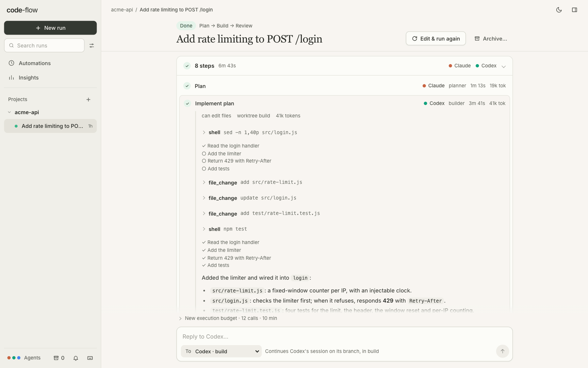

# Runs: talking to them, projects, restarts, insights

## The run view

A run reads like a conversation, top to bottom:

- **The header** stays at the top as you scroll (on wider screens): status, the task's first line, the pattern, and **Resume**, **Edit & run again**, **Archive…** or **Stop run**.
- **Your task**, as the message that started it, with any context you gave.
- **The agents' work**, as one list of steps ("4 steps · 6m 2s"). It's open while the run is going and folds away once there's a result. Open any step to see its transcript inline: the agent's messages (rendered as Markdown), its tool calls as one-line rows that expand to the full input and output, and its thinking, collapsed. <kbd>[</kbd> and <kbd>]</kbd> move between steps.
- **The result**, with its branches and what you can do with them (see [Review and ship](github.md#review-and-ship)).
- **The reply box** at the bottom (below).

<picture>
  <source media="(prefers-color-scheme: dark)" srcset="images/transcript-dark.png">
  
</picture>

## Talking to a run

Runs are conversations, not fire-and-forget jobs:

- **Approve the plan:** tick *Let me approve the plan* (the subtasks for Supervisor, the tests for Test-first). The run pauses at that checkpoint, and its time budget with it.
  - **Approve:** the agents start building.
  - **Ask for changes:** your note goes to the author, who revises in its own session and asks again.
  - **Reject:** the run ends without building anything.
  - A pending checkpoint survives restarts. Waiting runs show under *Needs you*, with a notification.
- **Message the team** while it runs, from the reply box. **To** picks the agent, or *Next agent* gives the note to the first one that can take it. A line next to it says where the note will go.
  - **Into a running Codex turn:** Codex runs through `codex app-server`, so a note for Codex (or for anyone) reaches its running turn right away, as a new message on the live thread (`turn/steer`). Codex takes it into account from its next step, without waiting for the turn to end.
  - **At the start of the next turn:** Claude, agy, and Codex on the `exec` fallback can't take input mid-turn. Their notes are added to the start of that agent's next turn.
  - The run view shows each note as queued or delivered, and which step it reached ("✓ delivered to codex mid-turn (Implement plan)"). A mid-turn note also shows in that step's transcript. If the turn ended just as the note arrived, the note goes back in the queue for the next turn. If the step is retried, the retry gets the note in its prompt.
- **Reply** after it finishes, from the same box:
  - to an agent in its worktree (**To:** e.g. *Codex · build*): it continues its own session, then code-flow commits and re-runs the check;
  - or to *Whole team · new run*: a new run that starts from this run's result branch, with your feedback added to the task.

<kbd>↵</kbd> sends and <kbd>⇧</kbd><kbd>↵</kbd> adds a line.

### A single agent

A **Single agent** run is one conversation with one agent, as in that agent's own app:

- The run reads as a chat: your messages, and each turn the agent takes. A turn streams live while the agent works. Once it's done, it folds into the agent's answer, with **Show work** for its tool calls and thinking.
- There's no **To**: every message goes to that agent. A message you send while it works goes into its running turn if the turn takes input (Codex). Otherwise it's sent as your next message as soon as the turn ends, so nothing waits for a reply you'd have to send again.
- A turn that fails ends that turn, not the conversation: reply to try again or to change course. Whatever it changed is kept on its branch.
- code-flow commits after every turn and runs your check if you set one. The branch, and merging it or opening a pull request, are at the bottom of the thread.

Prompts are passed on **stdin**, not as command-line arguments (`claude -p` reading stdin, Codex's JSON-RPC or `codex exec -`, and agy's stream-json input), so long tasks and diffs aren't limited by the operating system's argument size.

## Projects

Runs are grouped into projects. A project has a name and the repositories its runs work in.

- **No setup:** the first time you start a run in a repository that no project holds, code-flow makes a project named after it. The first time you start a code-flow that has projects, every repository that already has runs gets one, so your runs are grouped from the start.
- **The sidebar** lists every project with its runs under it, the projects with the newest runs first. Click a project's name to open its page, or the arrow next to it to fold it. Hover it for **+** (a new run in that project) and **⋯** (rename it, change its repositories, or delete it). Projects with nothing to list fold into one *more projects* line, each with how many archived runs it has. **+** next to *Projects* makes a new one.
- **A project's page** shows what needs you, what's running, recent results with their check and pull request state, the project's automations and inbox, and the week's numbers (runs, checks passed, cost). Its task box opens the composer in the project. The side panel shows the project meanwhile.
- **The project button** (in the composer, on Insights and on the Automations page, or <kbd>p</kbd>) picks the project you're in: new runs start in it, and Insights and the [Automations page](automations.md#projects) show it. With *All projects*, a new run goes in its repository's project.
  - The Automations page says when other projects have results or automations too, with a link to show all.
  - The read-only [phone view](automations.md#phone-view) lists every project's runs, each under its project's name.
- **Switching projects** moves the composer to the project's repository you used last, and to the pattern and team you last started a run with there from the composer (chats in the side panel don't change it). Each project remembers its own.
- **Several repositories:** a project can hold several, and a repository can be in several projects. Each run still works in one repository. **New project** and **Edit** in the switcher name a project and add or remove its repositories.
- **A run's repository always belongs to its project.** Starting a run in a project, or moving one there, adds the repository if it's missing. The composer says so before you start.
- **Moving a run:** click the project chip at the top of the run. Its branches and worktrees stay where they are.
- **A side-panel chat** starts in the project you're in, like a run from the composer.
- **Runs started from other runs stay in that run's project:** replies to the whole team, chats started from a run's result, comparisons, sweeps and automations. An automation whose project was deleted starts its runs in its repository's project.
- **Deleting a project** keeps its runs; they show under *No project*. Taking a repository out of a project keeps the runs already in it.
- Projects are saved in `~/.codeflow/projects.json`. Each run records its project in its own log.

## The side panel

The panel on the right (the button at the top right, or <kbd>\</kbd>) follows what you open, like the side pane in Claude's or Codex's app. On a run (or its review), every tab is that run's: its project, its repository and its worktrees. On a [project's page](#projects), the composer and elsewhere, it's that project and repository. The line at the top of the panel says which. The pin keeps the panel on one run or project while you open others; **Follow** lets go. **↗** opens the tab in a window of its own, for that run or project, and the panel here closes. Each run and project remembers its own tab, chats, terminals, folders and browser pages, so going back to a run brings its panel back. Drag the panel's left edge to resize it; a narrow panel names only the open tab.

Chat, Terminal and Browser keep what's open in a strip, like browser tabs: **+** opens another, a pill shows when one is working or has news, and **×** closes it.

- **Chat.** On a run, a side chat works in the run's own worktree, as a conversation of its own with the agent you pick: messages to the run's agents never reach it, and a reply to the run never continues it. **Ask** only reads, and leaves the result and its check as they were. code-flow doesn't undo what changes in the worktree while an Ask runs, since you may be working there too; a warning names the changes instead (agy can write even in an Ask: see [caveats](security.md#caveats)). **Change** edits the worktree: code-flow commits the change on the run's branch, runs the check, proves it again and updates the result, as it does for a reply; the steps it takes (the check, the proof) are the side chat's, not in the run's timeline. A message sent while the team is still working waits for it to finish, then gets a time and step budget of its own. If the run fails or is stopped before the message's turn starts, it ends with a note saying so: resume the run, then send it again. A turn the run stopped in the middle of waits instead, and resuming the run finishes it. The run's thread stays the team's: a side chat's turns aren't in it, and a change one made gets one line there, with a link back. **☰** lists every chat, closed ones too, and **Separate chat** starts a [Single agent](#a-single-agent) run on a branch of its own, from the run's result. In a project, a chat is such a run (it has no worktree to share): it shows in the sidebar, keeps its session and its branch, and **Open** shows it as a run.
- **Changes** (on a run) lists what it changed: the whole result branch, or just its **last step** (the latest commit, a side chat's change, say), with a diff per file, kept up to date while the run works. Click a line to comment; comments go to the agent that wrote the code, and their drafts are shared with the full-width [review](github.md#review-and-ship) (**Full review**).
- **Files** lists the folder's files (ignored files hidden; **M** changed, **U** new), with search. A file opens in a viewer with line numbers. On a run, the folder picker offers the run's worktrees and starts on its result's, so you can read what the agent wrote before merging; a project with several repositories offers each. From the composer, **+** and dragging add a file to the task's context.
- **Terminal** is a real terminal in a run's worktree (its result's, to start with) or the repository: your login shell in a pseudo-terminal, so prompts, colours, pagers and full-screen programs (`vim`, `htop`, `less`, `git log`) work, mouse clicks and scrolling too, and it fits the panel as you resize it. The first one opens when you show the tab. **+** opens another in any of them, and **Split** shows two, one above the other (drag the line between them). An app the run started with **Run app** can be shown as a read-only log, which stays after the app exits, marked *exited*. A shell stays open between commands, so `cd`, exported variables and virtualenvs stick. Its pill names what's running in the foreground; <kbd>Ctrl</kbd>+<kbd>C</kbd> stops the command, and **Stop** ends the shell with everything it started and opens a new one in the same folder. Copy and paste with <kbd>⌘C</kbd>/<kbd>⌘V</kbd> (<kbd>Ctrl</kbd>+<kbd>Shift</kbd>+<kbd>C</kbd>/<kbd>V</kbd> elsewhere). A terminal you come back to, or reload, shows what it showed before (the last 256 KB). Up to 12 shells stay open; a new one takes the place of the oldest idle one, never one that's running something, in the foreground or in the background (`npm run dev &`, a stopped `vim`). If all 12 are, opening another says so: stop or close one first. Closing one ends everything it started, `nohup`'d and disowned jobs too, and stopping code-flow closes every shell the same way. The pseudo-terminal needs `python3` (3.6 or later, standard library only; `CODEFLOW_PYTHON` picks another). Without it a shell is fed through a pipe: commands run one at a time and each reports its exit code, there are no pagers, prompts or full-screen programs, colours are off, and <kbd>↑</kbd>/<kbd>↓</kbd> recall commands.
- **Browser** shows pages of its own: on a run, the app it started with **Run app** first (the result card's **Show in panel** opens it too), or any address. **Phone**, **Tablet** and **Full** set the width, and **Compare** shows two pages side by side (another worktree's app, a race contestant's). An app on this computer (an `http://` address on `localhost` or `127.0.0.1`) is shown through a preview on a port of its own, which lets you annotate it:
  - **Pick** an element, or draw a **Box** over an area: each is a numbered pin with a snapshot, and you say what's wrong. **Adjust** tries style changes (size, colour, spacing) on a picked element right in the page; what you try goes with the pin. Pins stay when the page loads again, but **Adjust** can't reach them any more: their elements went with the old page.
  - **Console** lists the page's errors, failed requests and files that didn't load; they can go with the pins.
  - **Add to main chat** puts the pins and their snapshots in the run's message box, to add a line to and send; **Send to** picks a side chat that's running or done, a new side chat (once the run has a result), or a new run's task instead. Pins from different pages each say which page they're on. Snapshots sent with a reply are saved in the worktree's `.codeflow-context/` folder, which is never committed, and named in the message.
  - The preview is a different origin from code-flow (its own port), so the app's scripts can't use your code-flow session, and code-flow's cookies are taken off every request before it reaches the app. It uses the host name you opened code-flow with, so the app's own sign-in works in the frame. It passes WebSockets through (hot reload works) and takes requests only addressed to itself. It keeps the app's Content-Security-Policy, adding only what lets code-flow's page show it in a frame and run the annotations, and leaves out X-Frame-Options. Snapshots are drawn from the page's own elements: images from other sites and some fonts don't show in them, and a password you typed shows as dots.
  - Sites that refuse to be shown inside another page open in a new tab with **↗**.
- **Snapshot** works on any page, on this computer or not: code-flow opens the address in a headless Chrome (or Chromium, Edge or Brave; `CODEFLOW_CHROME` picks one) with a fresh, empty profile, at the width you picked (Phone 390, Tablet 768, Full the page's width in the panel), and shows the picture in place of the page. **Whole page** takes the full height (up to 12,000 pixels), zoomed out as a phone would show it when the page isn't made for phones, **Retake** takes it again, and **Live page** goes back. Drag on it to draw boxes (on a touch screen, turn on **Draw** first; otherwise a finger scrolls): each is a numbered pin with its crop, sent like any other, and the whole snapshot with the boxes numbered on it goes along. A new snapshot asks before it drops boxes drawn on the old one, and going to another address goes back to the live page. It's what a signed-out visitor sees: no cookies or sign-in from your own browser, and anything that needs a click or typing first won't be in it. A snapshot takes a second or two and one Chrome while it lasts; one is taken at a time, an `alert()` on the page is answered OK, and its Chrome and profile are gone when it's done.
- **Notes** is a scratchpad per repository (the run's, or the project's) plus a general one, saved as you type in `~/.codeflow/notes.json`, so it's the same on your phone. **→ Task** adds the selection (or the whole note) to the task in the composer; **→ Chat** sends it to a new chat.

## Runs survive restarts

Every run is saved to disk as it happens (`~/.codeflow/runs/<run>.jsonl`), and the server rebuilds the run list from those files when it starts.

- **Interrupted runs:** if code-flow stops while a run is going (Ctrl-C, a restart, a crash), the run comes back as **Interrupted**.
  - **Resume** re-runs the pattern from the top. Each step that already finished (agent turns, checks, commits, worktrees) is replayed instantly from a journal (`<run>.journal.jsonl`), and real work continues at the first unfinished step. Nothing finished is redone.
  - Runs that hit a time or step limit, failed, or were stopped by you can be resumed the same way, with a fresh budget.
  - A recorded check is replayed only if the code it checked is still the code at that point. A recorded commit is replayed only if it's still in the branch's history. Anything else runs again.
  - Follow-ups on a finished run don't replay the pattern at all; only the follow-ups run, each with a full time and step budget, and the run's check result stands until one of them runs the check again. A follow-up that fails doesn't undo the finished run.
  - Resume is claimed at once, so a double click or a PR watch can't start the same run twice. If the last attempt is still wrapping up (listing its work), the new one waits for it. Archiving, merging and pushing wait until a resume has started, too.
  - Notes delivered to a turn that never finished, or failed, go back in the queue for the next turn (the retry, or the resumed run).
- **Sessions that are gone:** an agent continues its own conversation only from a turn that worked. If that conversation no longer exists (the CLI says so), the turn runs once more in a new conversation, given the task from the start. A conversation that couldn't be resumed is never recorded as the step's.
- **At startup:** a step still marked as running in a run that isn't (code-flow stopped or crashed while it ran) is closed as interrupted. Folders in a worktree root that no run owns are listed in `~/.codeflow/server.log`; code-flow never deletes them. A run log without a run in it is logged there too, rather than skipped silently.
- **Clean shutdown:** Ctrl-C or SIGTERM stops running agents and marks their runs interrupted. A second Ctrl-C exits at once.
- **One server per data folder:** a second server on the same `CODEFLOW_HOME` waits for the first to stop (as in a restart), then refuses to start. A crash mid-write can leave a line half-written; it's closed off before the next write, so it never corrupts the next line. Failed writes, such as a full disk, are counted and reported at `/api/health`.
- **Needs you:** finished runs you haven't opened, and interrupted runs, are listed at the top of the sidebar, whatever their project, instead of under it. The browser tab shows the count, and the bell at the bottom of the sidebar turns on desktop notifications for when a run finishes or needs you.

## Insights, comparisons and finding runs

- **Insights** (in the sidebar, or <kbd>i</kbd>) shows, per agent and per pattern, for the project you're in, one repo, or everything, over 7 days, 30 days or all time:
  - runs, how often the result passed its check, and how often it was proven (a test fails without the change; a weak proof, where the tests only fail to load without it, doesn't count);
  - race wins, loops each agent got green, and review findings other reviewers agreed with;
  - failed steps, tokens (input, output, cached) and time per step;
  - Claude's API-equivalent cost. Your plan isn't billed per token; it's a measure of size.
- **Compare setups…** (next to *Start run*) starts the same task with several patterns at once, each with the team you last picked for it, optionally 2–3 times each. Insights shows them side by side: result, time, steps, tokens, cost, whether tests were touched, and whether the result was proven. The best value in each column is highlighted.
- **Tokens and cost** also show on each step, in the run's details under the header (with a per-agent breakdown on hover) and when you hover a run in the sidebar.
- **Disk:** every worktree is a full checkout, often with its own `node_modules`. Insights measures them and **Clean up** removes the worktrees, not the branches, of runs that finished more than *N* days ago and need nothing from you.
- **Finding runs:** the sidebar lists every [project](#projects)'s runs, one line each: a status dot, the task and its age (hover for the rest). It has search (<kbd>/</kbd>) and, behind the button next to it, grouping by project or by status, filters (needs you, running, passed, failing, tests changed; pattern; agent; this repo) and **show archived runs** (also the archive button at the bottom of the sidebar). While you search or filter, matching archived runs show too. <kbd>j</kbd>/<kbd>k</kbd> move between runs. In a run, <kbd>[</kbd>/<kbd>]</kbd> move between steps. <kbd>\</kbd> shows or hides the side panel. <kbd>?</kbd> lists every shortcut. Run status changes are announced to screen readers.
